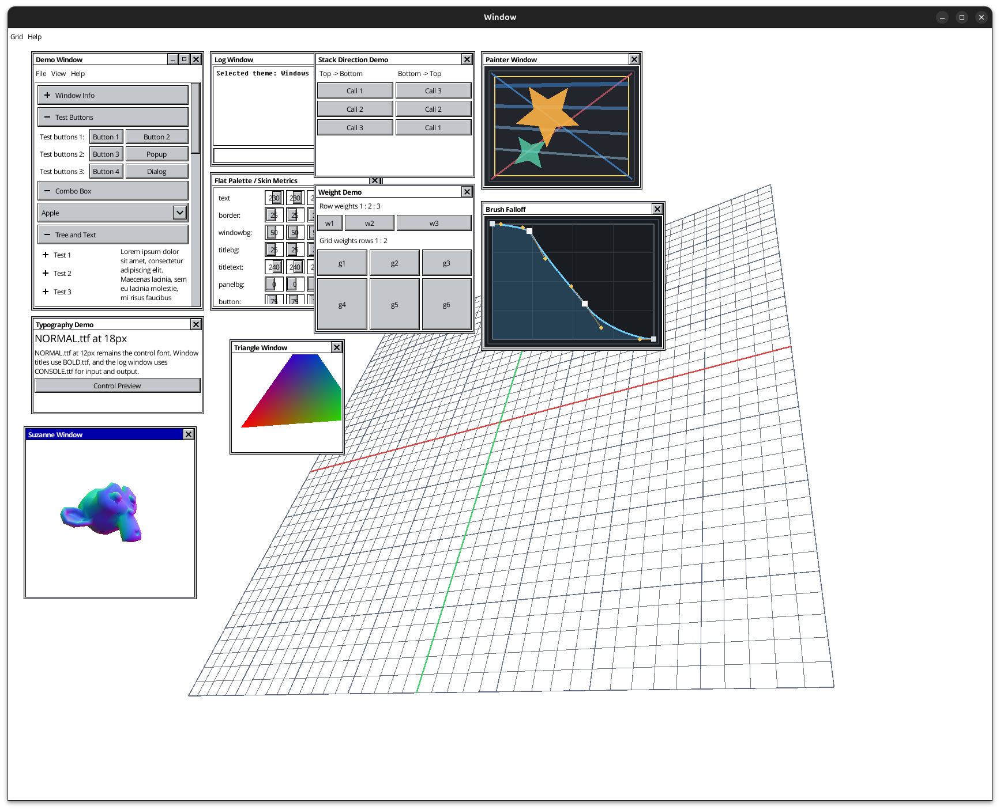
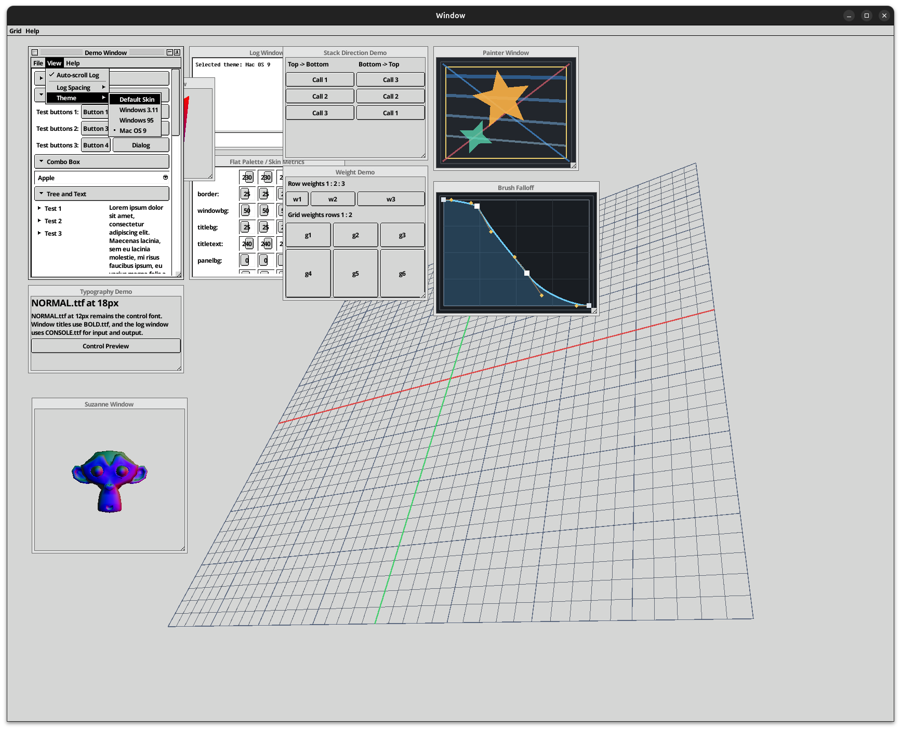

# NeoCogi UI

[](https://crates.io/crates/neocogi-ui)

NeoCogi UI provides components, runtime services, UI, rendering, and
tools for building modular Rust applications across native platforms and the
browser. Its retained UI grew from [rxi/microui](https://github.com/rxi/microui).
Applications use a thin, statically linked typed facade. Concrete COM objects
own widgets, containers, the UI runtime,
windows and renderer resources. Native deployments load a few independently built
plugins; browsers register the same interfaces with one static runtime.

This checkout is **0.9.0-alpha.0**, pre-alpha. Its API and binary contracts may change
without compatibility layers. The imported neocogi-com implementation is maintained in
this workspace. Concrete controls such as `Button` are callable COM class contracts;
shared protocols such as `IWidget` and `ILeafLayout` remain interfaces on the same
object and state.

The workspace/repository name is `neocogi-ui`. Cargo packages keep
descriptive `neocogi-*` names, while deployed libraries use the short `nc_*`
targets (`nc` means NeoCogi). See the [shared-library mapping](docs/COM_NATIVE.md#profiles-and-output)
and [executable mapping](docs/EXAMPLES.md) for exact outputs. The assembly command
remains `cargo neocogi`.

| Windows 3.11 | Mac OS 9 |
| :--: | :--: |
|  |  |

## Run the demos

Install the assembly tool from this checkout, then build and run a complete native package:

```sh
cargo install --path tools/cargo-neocogi
cargo neocogi run --assembly full
```

Use `--variant vulkan` or `--variant wgpu` to select another renderer; the default
is Glow. Other assemblies are `simple`, `calculator`, `backend-frame-cube`, and
`smoke`. Use `--release` for an ordinary release package, or `build` instead of
`run` to stage without launching. The command prints the resulting directory.
Native assets are external by default; keep the staged `assets` and `themes`
directories with the executable. Add `--variant embedded` after the renderer
variant for an explicit embedded deployment. Assembly definitions live in
`[workspace.metadata.neocogi]` in [Cargo.toml](Cargo.toml).
The [tool reference](tools/cargo-neocogi/README.md) documents configuration,
versioned crates.io components, standalone TOML, and lockfiles.
The [package guide](docs/COM_NATIVE.md) covers dependencies, nightly min-size builds,
optional assets, actual GPU tests and executable-relative loading. A native demo
needs its adjacent runtime and plugin manifest; direct `cargo run` on the demo
package does not assemble those files.

## Workspace layout

COM infrastructure lives under `crates/com`: `core` defines the
ABI vocabulary, `macros` generates typed projections, `api` is the safe client
surface, and `runtime` owns process-wide loading; the facade selects shared or static linkage.
Build-time IDL tooling lives under `crates/com/idl`: `core` owns parsing, resolution,
and fingerprints, while `build` is the reusable contract-crate `build.rs`
integration. Contract examples live under `tools/idl`. The reusable tooling remains
separate from `tools/cargo-neocogi` so ordinary Cargo builds can regenerate
contracts without invoking the assembly CLI.
UI code follows the same role-based layout under `crates/ui`: `core-contracts` contains
shared node, layout, popup, menu, and window protocols; `nodes-contracts` owns the concrete
built-in widget/container classes and their typed factory; and `api` is the application facade.
`runtime` implements and deploys the retained forest, surfaces, generic menus, and window manager.
`nodes` deploys built-in leaves, containers, Combo headers, and standard file-dialog
compositions as a separate provider. Their concrete `.rs` implementations live under
`nodes/src/widgets`, `nodes/src/containers`, and `nodes/src/dialogs.rs`; core contains no built-in
catalog or concrete factory. `support` holds only binary-local resource imports, pure presentation
algorithms, and phase-local drawing helpers. Neither provider has a production dependency on the
other provider's Rust implementation, and there is no extra runtime-plugin wrapper crate.

The core runtime and built-in nodes are deliberately separate plugins. A host creates the core
runtime, activates `neocogi.ui.nodes.runtime`, and binds its `NodesPluginFactory` to that exact
runtime. The core never exposes or constructs `UiFactory`; host identity validation prevents a
factory bound to one runtime from being paired with another. External leaves and containers use
the same typed protocols and cached hot-path capabilities as built-ins.

Platform-normalized input, polling, native text-input placement, and window
construction live in `crates/platform/contracts`; immutable native paths live
there as well because both file dialogs and resource loaders consume them. The `neocogi.platform` ABI
depends only on `neocogi.renderer`; it accepts a narrow `IRgbaImage` and contains
no widget, skin, font, icon, or asset-catalog declaration. The current backend
plugin still co-locates platform and renderer implementations so no raw native
window or graphics handle crosses a dynamic boundary.

Rendering follows a deployment-oriented layout under `crates/render`. Glow,
Vulkan, WGPU, and WebGL builds have distinct plugin identities. Each renderer plugin
also owns the native window/device integration it needs, so graphics handles stay
private. UI sends coarse painter-order operations to GFX, which submits one bulk
frame to the selected renderer. The backend-specific
Rust crates and shared helpers remain separate source concerns within that artifact.
`crates/render/contracts` owns the independent `neocogi.renderer` ABI: geometry,
raw RGBA images, GPU texture capabilities, and one bounded bulk frame stream. It
contains no UI asset or skin declarations; `IAssetBundle` merely exposes an
`IRgbaImage` capability returned by `IAssetBundle::image()` to the renderer.
`crates/render/core` is their small, statically linked backend SPI; it is not another
plugin and does not depend on the UI runtime implementation.

`crates/gfx` owns the `neocogi.gfx` decoding and resource-baking plugin, while
`crates/skin` owns the `neocogi.skin` appearance and external-theme plugin.
The GFX contract owns complete portable bundles and the renderer-neutral compositor,
so both UI and Skin depend on GFX instead of resource construction or final graphics
execution depending backward on the retained UI.
Their concrete compiler machinery lives in separate private GFX and Skin
implementation crates. Portable bundle publication and validation live in
non-plugin `crates/gfx/support`, while a small appearance crate contains only
pure typed appearance compilation. None of these support crates publishes a
plugin identity. The split keeps PNG, font, and atlas services out of skin-only
clients, and keeps JSON/schema services out of GFX clients. User-defined UI plugins belong outside the platform crates;
`examples/ui-extension` demonstrates an
independently compiled leaf and container. A COM object is not automatically a
deployment plugin: the complete built-in family shares one nodes provider, while logical windows,
generic menus, and popup policy share one core runtime provider.

See [component and plugin boundaries](docs/COMPONENTS.md) for the complete
dependency graph, ownership rationale, resource policy, and frame-cost invariants.

For the browser:

```sh
scripts/web-demo.sh serve
```

The WebGL renderer plugin owns its canvas and DOM input/IME bridge. All four demo themes,
images and custom drawing examples remain available. See [WEB.md](docs/WEB.md) for
input limitations and the native-filesystem picker's browser restriction.

## Typed application code

Depend on the local facade while using this pre-alpha checkout:

```toml
[dependencies]
neocogi-ui = { path = "../neocogi-ui/crates/ui/api" }
neocogi-com = { path = "../neocogi-ui/crates/com/api" }
```

Once the host has activated `UiRuntimeAbi`, the facade creates and edits the actual objects:

```rust
use neocogi_ui::*;
use neocogi_com::{ComPtr, NcStatus};

fn install(ui: &Ui) -> Result<ComPtr<IWindowAbi>, NcStatus> {
    let hello = ui.widgets().button_unobserved("Hello, world!")?;
    let mut content = ui.widgets().linear(FlowDirection::TopToBottom, CrossSize::Stretch)?;
    content.insert(0, &hello, LinearEdge::new(LayoutTrack::Content))?.finish()?;
    ui.window("Hello", Rect { x: 40, y: 40, width: 300, height: 120 }, &content)
}
```

`UiFactory` belongs to the independently activated `neocogi.ui.nodes.runtime` plugin. Its
`NodesPluginFactory::bind` method consumes a borrowed `UiRuntime`, queries the public
`IConstructionHost`, `IChoiceMenus`, window, and resource capabilities it needs, and returns one
host-bound factory. `Ui::from_interfaces(runtime, factory)` verifies that both sides expose the
same canonical `IWidgetHost` identity before the facade permits construction. No class ID,
untyped argument object, private runtime pointer, or root identifier crosses that boundary.

Supply a sender and typed mapper when constructing observed widgets, for example
`ui.widgets().textbox("", sender, mapper)`. One generated observer covers all of
the widget's outputs; `textbox_unobserved` omits it. A persistent
`events::Controller<Model>` owns ordinary model state and its standard channel
receiver. Resolve `IEventOwner` once, then call
`ui.update_with_events(size, owner.as_com_ref())` each frame. Nested components
use that same controller contract and attach their view/owner explicitly; the
runtime settles descendants before application messages and later raw input.
The host then synchronizes text-input geometry and renders.
Setters retain invalidation; custom widget updates report `GeometryChange::Changed`
when measurement or placement inputs change. Resize invalidation is independent.

External shared state, hidden/skipped updates and observational painting remain
explicit widget/app responsibilities. Read [COM_AUTHORS.md](docs/COM_AUTHORS.md)
for the complete requirements and examples. Local custom leaves implement
`LeafContent`; GPU scenes expose concrete interfaces such as `IMeshScene: IRenderItem`.
Backend-owned Rust GPU types stay inside their renderer plugin.

The [documentation index](docs/README.md) links authoring, assets, deployment and
implementation references. [Examples](docs/EXAMPLES.md) maps each feature to working
source. [FEATURES.md](docs/FEATURES.md) defines current feature ownership, while
[COM_DESIGN.md](docs/COM_DESIGN.md) defines the accepted component architecture.

## License

Project-authored code uses the [BSD 3-Clause License](LICENSE). Imported neocogi-com and
portions derived from rxi/microui retain their MIT terms. Bundled assets retain the
licenses recorded in [asset attribution](docs/ASSETS.md).
