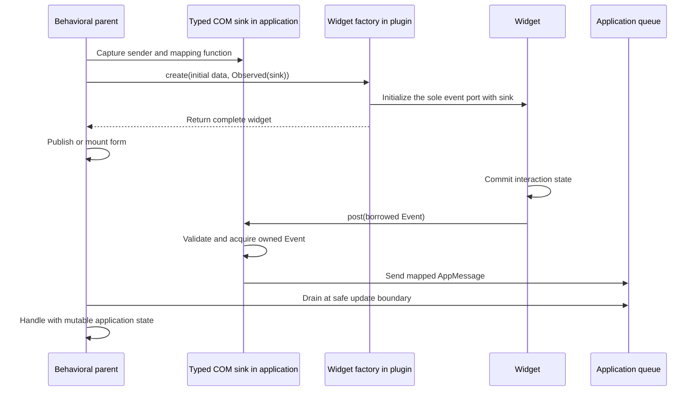
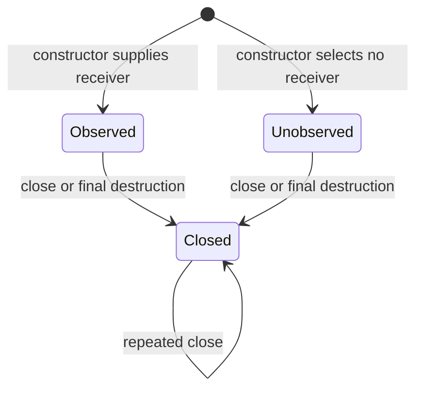

# Constructor-bound widget events

An emitting widget owns one typed event port, with one receiver selected by its
behavioral parent **during construction**. Several event kinds are variants of
one enum, such as `TextboxEvent::Changed` and `TextboxEvent::Submitted`. They do
not create separate ports. Event routing belongs to application code.

The IDL uses ordinary interfaces, classes, factories, enums and structs. It has
no widget keyword, event declaration, per-variant subscription, or visual routing
language. The former `IEventStream::attach` protocol and `com_class(event = ...)`
option have been removed. A published object has no receiver-installation method.

## Construction and delivery



In text: the application builds a sink, passes it into the factory, and receives
a fully initialized widget. Later the widget calls that sink, whose mapper posts
to the application queue. Application behavior runs after traversal releases
its borrows. There is no intermediate loader queue or form relay.

The sink owns the sender and a typed mapping closure in the application's binary.
Neither the application's private message type nor a Rust closure crosses COM.
The widget does not receive `Rc<RefCell<Parent>>`, a parent pointer, or a function
pointer with an unspecified lifetime. It retains an ordinary checked COM receiver.
Mapping runs synchronously: it should capture facts, not reenter the emitter or
run application behavior under the emitter's mutable COM call gate.

## Ordinary IDL contracts

Versions and imports are omitted in this illustration:

```text
interface IMessageSink<E> {
    fn post(&mut self, message: &E) -> Result<()>;
}
enum EventBinding<E> {
    Unobserved,
    Observed(ComPtr<IMessageSink<E>>),
}
enum TextboxEvent {
    Changed(TextChanged),
    Submitted(TextSubmitted),
}
class Textbox: IWidget + ILeafLayout {
    fn set_text(&mut self, text: &[u8]) -> Result<()>;
}
factory Widgets {
    fn create_textbox(&self, text: &[u8], events: &EventBinding<TextboxEvent>)
        -> Result<ComPtr<Textbox>>;
}
```

`EventBinding` is an ordinary library enum using the checked recursive value ABI.
`Observed` owns a `ComPtr` to the exact `IMessageSink<E>` specialization.
`Unobserved` chooses permanent non-delivery, useful for previews. It is not an
empty subscription slot. Closing or dropping the widget never permits rebinding.

Each closed sink specialization has a concrete vtable, deterministic IID and ABI
signature. Different generated Rust names for the same specialization can be
bridged by checked `QueryInterface`. Event payloads always retain their concrete
value types; `IUnknown` is never used as an event payload substitute.

The backend finds methods returning `ComPtr<Product>` in the product's declaring
contract module. An `EventBinding<E>` argument identifies its constructor receiver.
It generates `ProductEventBinding`, `ProductSinkAbi`, `ProductSink`,
`ProductSinkVtblFor`, `ProductEventPort`, and an `EventSource` implementation for
`ProductAbi`. Two binding arguments on one constructor, or different event types
among that product's constructors, are rejected. Constructors without a binding
can intentionally create unobserved products.

This association is local to the declaring module: importing a downstream
factory cannot change a published product's metadata. A custom factory returning
a product from another module must honor that product's canonical receiver
contract. IDL cannot prove the implementation's ownership discipline; a foreign
implementation remains responsible for retaining exactly that receiver and
releasing it correctly, as with every other COM contract.

The product's `IDL_INTERFACE.event_sink` describes the **receiver**, not an
interface implemented by the product. Interface inheritance therefore cannot
introduce another consumer slot. Commands remain in the product's own interface
chain, independently of the event receiver. `com_class(Contract)` allocates the
ordinary concrete implementation; it does not generate event attachment methods.

## Producer ownership and closure

The implementation keeps a private `ProductEventPort` field. Its constructor
decodes `events.to_owned()?.into_sink()` and initializes
`EventPort::with_sink(receiver)` before publishing any widget identity. Internal
composites pass that receiver to their actual emitter: TextArea to its editor,
Combo to its choice model. They do not add forwarding ports.

| State selected at construction | `post` | `close` |
| --- | --- | --- |
| Open with receiver | Call the sole typed receiver | Drop receiver and become Closed |
| Open without receiver | Succeed without delivery | Become Closed |
| Closed | Return `NC_E_CLOSED` | Remain Closed |



There is no transition from Unobserved to Observed, or between receivers.
`EventPort` mutates through `&mut self`; ordinary COM borrowing supplies reentry
checks. Cloning a `ComPtr` shares the same producer and never creates another port.
Dropping a cloned handle does not close a live widget. Final allocation release
runs the concrete widget's `Drop`, which invokes its idempotent `close` path.

Composite closure proceeds in this order:

1. Check that closure is currently allowed; an already closed widget succeeds.
2. Close descendants. A refusal before their cleanup commits leaves the parent open.
3. Release the parent's mapping and local editing/gesture resources.
4. Mark the parent closed. Return any diagnostic from cleanup that already committed.

No cancellation protocol is introduced. A committed cleanup diagnostic does not
undo removal or reopen the parent. Ordinary ownership drops receiver references
on final destruction even if a best-effort close reports an error. Explicit
closure remains necessary when external COM handles retain a removed widget.

A structural parent need not consume events. A textbox inside a scroll area can
send directly to its form's queue. A behavioral composite such as FileDialog
consumes its private children's events and exposes its own completion protocol.

## Application code and generated forms

```rust,ignore
let (sender, messages) = std::sync::mpsc::channel();
let save = ui.widgets().button("Save", sender.clone(), AppMessage::SaveButton)?;
let name = ui.widgets().textbox("", sender.clone(), AppMessage::NameTextbox)?;
```

Here `SaveButton(ButtonEvent)` and `NameTextbox(TextboxEvent)` are tuple variants
of the application's enum; their variant constructors are mapping functions.
`textbox::sink` creates the adapter separately, and `textbox_with_sink` supplies
it through the same COM constructor. `filter_sink` can omit selected variants
from the queue while remaining the one consumer. `_unobserved` helpers allocate
no receiver. Windows and popups offer `*_with_sink`; menus offer
`item_observed`, `item_with_sink`, and `popup_with_sink`.

Generated forms retain typed widget fields and require a handler per emitting
widget. They expose two separate setup functions:

- `events(generation, sender)` builds an `EventBindings` table **before** loading.
- `bind(&component)` checks and resolves concrete widget and input fields after
  construction; it does not install receivers.

`Loader::compile_with_events(document, bindings)` and
`load_with_events(bytes, bindings)` validate every supplied key and exact receiver
identity before construction. Duplicate entries, unknown keys, bindings for
non-emitting widgets, and wrong event types are errors. Missing entries mean
permanently unobserved widgets. Plain `prepare` and `load` choose that policy for
all nodes. Live mappings never appear in persisted documents.

`ReloadSlot::reload(document, resources, make_events, check_fields)` assigns an
attempt generation, prepares receivers, constructs the candidate, checks its
fields, and then publishes it. Any failure preserves the old component and
releases candidate mappings. Generated messages carry that generation; the
application checks `slot.accepts(message.generation)` before dispatching their
`Event` through its `Handlers` implementation. An omitted handler fails Rust
compilation. Handlers can edit the form's actual typed widget fields.

## Independently built custom plugins

`IDesignWidgetCatalog::describe` transports catalog revision 6: the concrete
product identity, constructor receiver IID/signature, complete reachable value
graph, Rust binding paths, and property defaults. The designer need not link the
plugin's contract crate to inspect that data or render an unobserved preview.

The common `create_widget` call receives a `WidgetEventBinding`: Unobserved, or
Observed holding a COM `IUnknown` reference. This transports an object capability
through a heterogeneous catalog, not an untyped event. The selected plugin
constructor **must query its exact `IMessageSink<E>` before allocating the widget**.
A wrong sink fails that query. The loader checks each supplied receiver against the registered catalog
descriptor before construction; the registry checks the returned widget against
its product IID.
It never queries the widget for a receiver interface.

Compiled application forms still depend on the custom contract crate to name
actual widget fields and event values. The generic designer inspects custom
event shapes; it does not dynamically interpret unknown event payloads for its
preview trace. Application routing remains application code.

## Costs and error boundaries

A standard sink is one COM allocation containing its mapper and sender. The
widget factory retains that receiver; there is no second relay allocation.
Event acquisition uses the normal recursive wire checks, shared allocation
budget and fallible reservations. Owned strings and channel storage can allocate.
This is not a promise of allocation-free posting.

A receiver error is returned after any producer state change that already
committed. Already queued values survive producer closure. A disconnected queue
still runs the mapper, then discards the translated value successfully. Closing
releases the widget's receiver reference; separately retained sink handles can
keep captures alive. Capturing the producer itself in its mapper can create a
reference cycle, so ordinary mappings should capture senders and immutable IDs.

See [COM receiver API](../crates/com/api/EVENTS.md),
[runtime scheduling](../crates/ui/runtime/docs/EVENTS.md),
[generated forms](../crates/ui/document/README.md), and
[IDL syntax](IDL_MODULES.md).
