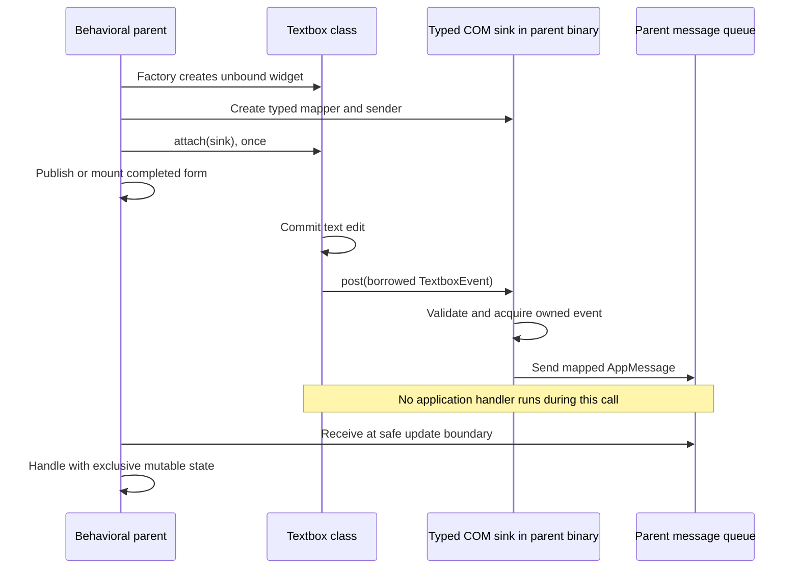
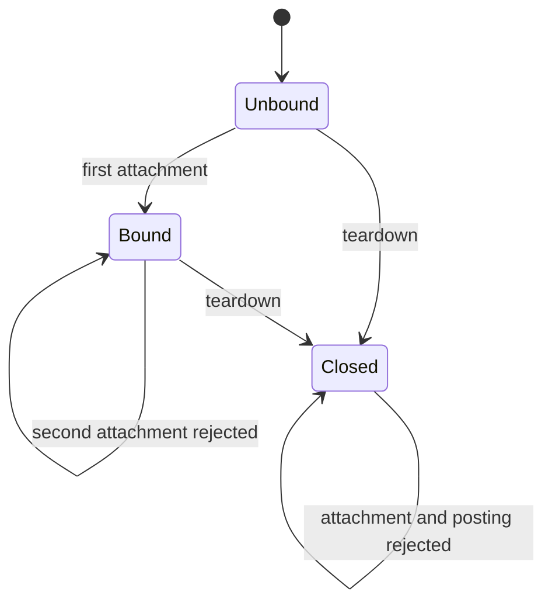

# Concrete classes and one typed event stream

An emitting widget is a concrete COM class with two kinds of capabilities:
commands the application can call, and one typed event stream. The widget's
behavioral parent attaches the stream to its own message queue. A generated
receiver acquires the event, maps it to an application message, and posts that
message. Application behavior runs later with `&mut self`.

The IDL contains ordinary interfaces, classes, factories, and data declarations.
There is no event-port declaration, `#[observer]` annotation, widget keyword,
visual routing graph, or per-variant subscription API.

## The complete path

```text
Textbox commits an edit
  -> IEventStream<TextboxEvent>'s attached IMessageSink<TextboxEvent>
  -> validate and acquire the borrowed message
  -> map TextboxEvent into AppMessage
  -> application mpsc queue
  -> safe update boundary
  -> Form/App handler with &mut self
```



The text path above contains the same information if a Markdown preview cannot
render Mermaid. The sink retains a sender and mapping closure. The widget does
not receive `Rc<RefCell<Parent>>`, a raw parent pointer, or the application's
private message type. The parent owns its receiver and ordinary mutable state.
Mappers run synchronously and should only capture and translate facts. They must
not call back into an emitting widget while its COM borrow is active.

## IDL and Rust implementation

The shared COM library supplies these ordinary generic contracts (versions and
imports omitted here):

```text
interface IMessageSink<T> {
    fn post(&mut self, message: &T) -> Result<()>;
}
interface IEventStream<E> {
    fn attach(&mut self, consumer: &IMessageSink<E>) -> Result<()>;
}

#[message]
enum TextboxEvent {
    Changed(TextChanged),
    Submitted(TextSubmitted),
}
class Textbox: IWidget + IEventStream<TextboxEvent> {
    fn set_text(&mut self, text: &[u8]) -> Result<()>;
}
factory Widgets {
    fn create_textbox(&self, text: &[u8]) -> Result<Textbox>;
}
```

`Changed` and `Submitted` are cases of the same event message. Neither is a
separate port. The factory returns a widget with an unbound stream. The Rust
convenience constructor `ui.widgets().textbox(text, sender, mapper)` creates the
widget and attaches its receiver before returning it to the caller.

Each closed generic has a concrete COM vtable, IID, and ABI signature. There are
no Rust generic parameters in a foreign vtable and no type-erased event payload.
The compiler derives identity from the template and argument identities;
signatures also reflect their ABI definitions. Separate modules specializing
the same contract agree on COM identity even when their generated Rust types
have different names. A checked `QueryInterface` bridges those Rust projections.

The generated `TextboxStreamAbi`, `TextboxSinkAbi`, and `TextboxEventPort`
aliases hide the mechanical specialization names. A producer explicitly owns
its port storage:

```rust,ignore
/// Concrete widget state; the remaining IWidget methods are omitted here.
#[neocogi_com::com_class(contracts::Textbox, event = events)]
struct TextboxImpl {
    /// Ordinary widget state, edited under the allocation's COM borrow gate.
    state: WidgetState,
    /// One irreversible attachment shared by every projection of this object.
    events: contracts::TextboxEventPort,
}
```

Initialize `events` with `Default::default()`. The macro implements the class's
stream `attach` method by delegating to that field. After committing state, the
producer calls `self.events.post(&TextboxEvent::Changed(snapshot))`; logical
teardown calls `self.events.close()`. The macro does not invent widget behavior,
state, a second queue, or a second consumer slot. Implementations still supply
their ordinary class and interface methods.

A composite that stores its public stream in an authoritative inner object uses
`#[com_class(Contract)]` and implements attachment delegation explicitly.
TextArea delegates to its text editor; Combo delegates to its choice-menu state.
Both paths reach the same single slot. A behavioral composite such as a file
dialog instead consumes private child events in its own controller and emits
its own public completion event to its behavioral parent.

## Attachment and ownership rules

| State | `attach` | `post` | `close` |
| --- | --- | --- | --- |
| Unbound | Retain the receiver; become Bound | Succeed without delivery | Become Closed |
| Bound | `NC_E_ALREADY_BOUND`; keep original receiver | Call original receiver | Drop receiver; become Closed |
| Closed | `NC_E_CLOSED` | `NC_E_CLOSED` | Remain Closed |



This is one consumer for the widget's entire lifetime, across all event variants
and all queried COM projections. Dropping an application handle to the sink does
not detach it: the stream retains its own reference. There is no replacement,
disconnect, or subscription list. An unbound widget deliberately discards events
so previews and intentionally unobserved controls can work.

The compiler rejects concrete classes that accumulate different event stream
types through their interface chain. An inherited stream counts exactly as a
locally required stream. Querying another interface cannot create another slot
in the supplied implementation. Interfaces remain reusable COM capabilities;
the one-stream check belongs to the concrete class contract.

The behavioral-parent rule is construction discipline, not access control. The
parent creates and binds its children before publishing the form. Neither COM
nor Rust can infer whether a user-written sink logically belongs to that parent.
An independently written implementation must honor attachment semantics, just
as it must honor its other interface contracts. `EventPort` and `com_class`
provide the standard enforcement; merely declaring an interface does not prove
a foreign implementation follows it.

A structural layout container need not consume child events. For example, a
textbox inside a scroll area inside a form can attach directly to the form's
queue. The scroll area is its structural parent; the form is its behavioral
parent. A file dialog with private validation is itself the behavioral parent
of its buttons and textboxes.

## Application APIs and generated forms

```rust,ignore
let (send, messages) = std::sync::mpsc::channel();
let textbox = ui.widgets().textbox("", send, |event| match event {
    neocogi_ui::textbox::Event::Changed(value) => AppMessage::Name(value.text),
    neocogi_ui::textbox::Event::Submitted(value) => AppMessage::Submit(value.text),
})?;
```

`textbox::sink(sender, mapper)` constructs the adapter separately, and
`textbox_with_sink(text, Some(sink.as_com_ref()))` attaches it after the COM
factory returns. `filter_sink` permits dropping selected variants; it still
consumes the complete stream. `textbox_unobserved` leaves the slot unbound.
For a concrete custom class, use
`neocogi_com::events::bind_source(widget.as_com_ref(), sender, mapper)`.
Window, popup, and menu convenience bindings use the same single-attachment
protocol, including after menu records move into the runtime.

Generated forms contain typed handles to the actual concrete COM widgets and a
required handler method for every emitting widget. An illustrative form with
button B and textbox T has this application contract (actual generated names
include ordinals to avoid collisions):

```rust,ignore
pub struct Form {
    pub widget_b_1: neocogi_ui::Widget<neocogi_ui::ButtonAbi>,
    pub widget_t_2: neocogi_ui::Widget<neocogi_ui::TextboxAbi>,
}
pub trait Handlers {
    fn on_b_1(&mut self, event: neocogi_ui::button::Event) -> Result<(), NcStatus>;
    fn on_t_2(&mut self, event: neocogi_ui::textbox::Event) -> Result<(), NcStatus>;
}
```

The application supplies `impl Handlers`; omitting a required method fails Rust
compilation. Its button handler can call `self.widget_t_2.set_text("Saved")`.
The designer does not generate executable widget-to-widget routes. It generates
checked fields, typed queue bindings, and dispatch through the handler trait.

The document loader constructs an unbound tree. Generated `bind` first resolves
all typed fields, then attaches each stream directly to the application's queue.
There is no loader event inbox or form-owned forwarding receiver. Document
`outputs` aliases remain display/trace names; they do not allocate another stream
or enable rebinding. Named input commands remain a separate integration feature.

`ReloadSlot::reload` binds a candidate before publishing it. Its generated
messages carry that attempt's generation. Before dispatch, the application checks
`slot.accepts(message.generation)` so queued events from replaced or failed
candidates cannot act on the new form. Candidate construction failure preserves
the previous form; partial candidates are closed.

## Custom widgets and COM discovery

A plugin root exposes `IDesignWidgetCatalog`. Its COM `describe` operation copies
a versioned `DesignWidgetManifest` containing concrete class identity,
the resolved stream identity and signature, message
shape, public Rust type paths, and constructor property defaults. The standalone
designer can read it without statically linking that plugin's Rust crate.

The IDL-generated `IDL_INTERFACE.stream` includes an inherited stream. Catalog
conversion verifies that its projection exists in the complete COM chain, and
the loader checks both advertised class and stream identities against each
constructed object. Schema revision 2 represents one optional stream, replacing
the old list of locally declared ports. No method-name convention is used to
infer event semantics.

Generated application code still depends on the plugin's contract crate so it
can name its concrete field and message types. The generic designer preview
renders custom controls and inspects their event shapes, but does not dynamically
decode unknown Rust event types for its status trace. Compiled generated forms
receive the custom class's complete typed stream.

## Delivery, allocation, and teardown

A receiver is allocated during binding and stores the typed mapper inline. Each
post crosses the sink's COM method. Its decoder validates and acquires variable
payload data before the producer's call-scoped storage expires. Message decoding
uses the existing cumulative byte/record budget, scalar wire validation, and
fallible allocation; this architecture does not bypass those checks. Owned text
and channel blocks can allocate. There is no promise of allocation-free posting.

Already queued messages retain their original values after widget closure.
Dropping the parent receiver discards its pending messages; a disconnected sender
is a successful no-op after mapping. Logical closure releases the widget's sink
reference. An explicitly retained sink handle can keep its captures alive. Avoid
capturing the producer or its owning UI in that producer's mapper, since that can
form a reference cycle. Capture the sender and immutable application identifiers.

`Controller<Model>`, `IEventOwner`, and runtime dispatch scheduling remain the
mechanism granting ordinary mutable access at safe boundaries. Bindings compile
in the consuming binary; producers call the same concrete COM protocol in both
plugin and monolithic assemblies. Rebuild contracts and consumers together.

See [runtime scheduling](../crates/ui/runtime/docs/EVENTS.md),
[generated forms](../crates/ui/document/README.md), and
[IDL syntax and ABI](IDL_MODULES.md) for the surrounding contracts.

## Verification of this migration

The following checks passed on Linux for this change:

```sh
cargo test --workspace --no-fail-fast
cargo check -p neocogi-ui-designer -p neocogi-runtime-ui-example -p neocogi-theme-editor --no-default-features --features webgl --target wasm32-unknown-unknown
SDL_VIDEODRIVER=offscreen cargo run -p neocogi-demo-smoke --features monolith,extension,embed-assets --bin neocogi-demo-smoke -- --smoke
python3 crates/com/scripts/check-markdown-links.py
```

The workspace run includes real generated COM stream calls, inherited stream
metadata, rejected second attachment, terminal closure, malformed-message and
allocation-budget regressions, compiled generated forms, reload/retirement,
and shared-library/monolith relocation tests. The optional native extension
smoke exercises an actual rendered frame and custom-widget event handling.
The WebAssembly command is a compile check, not a browser execution test.
Ignored documentation sketches and the opt-in nightly size test remain ignored;
this migration makes no new binary-size or allocation-performance claim.
