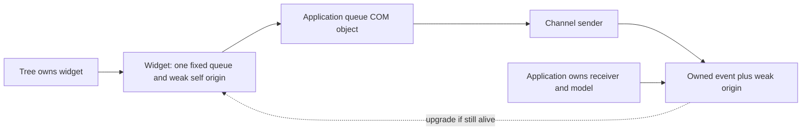

# Typed event queues and weak origins

A producer has one constructor-selected queue for its entire event enum. The
application implements the queue's concrete COM interface and enqueues its own
messages. Widget getters and setters stay on the widget's ordinary interfaces.
There is no attach operation, receiver replacement, event-owner object, or visual
routing language. Application behavior runs after the emitting widget returns.

## Contract and syntax

These are ordinary generic library declarations, not UI-specific IDL syntax:

```rust,ignore
interface IEventQueue<Object, Event> {
    fn post(&mut self, origin: &Object, event: &Event) -> Result<()>;
}
enum EventBinding<Object, Event> {
    Unobserved,
    Observed(ComPtr<IEventQueue<Object, Event>>),
}
class Button: IWidget { /* getters, setters and widget operations */ }
enum ButtonEvent { Activated(Activation) }
factory Widgets {
    fn button(&self, label: &[u8], events: &EventBinding<Button, ButtonEvent>)
        -> Result<ComPtr<Button>>;
}
```

`Object` must be an interface/class; `Event` must be a declared value. The IDL
backend checks that the binding names the constructor's returned product as its
origin, that a constructor accepts at most one binding, and that constructors of
the same product agree on the event type. Generics still produce concrete ABI
interfaces and checked value codecs. Neither Rust generics nor channels cross COM.

`post` borrows both arguments for the synchronous call. Generated Rust receives
`ComRef<'_, ButtonAbi>` and `NcValueRef<'_, ButtonEvent>`. Retaining the event
requires `to_owned()`, which uses the existing checked, budgeted value decoder.
Retaining only the origin's identity requires `origin.downgrade()`.

## One concrete application queue

A single object can implement `ButtonEventQueue` and `TextboxEventQueue`. Every
button can share its button projection and every textbox its textbox projection.
The following abbreviated Rust illustrates the application-owned boundary:

```rust,ignore
enum AppMessage {
    Button(WeakComPtr<ButtonAbi>, ButtonEvent),
    Textbox(WeakComPtr<TextboxAbi>, TextboxEvent),
}
#[com_object(interfaces(ButtonEventQueue, TextboxEventQueue))]
struct AppQueue { sender: std::sync::mpsc::Sender<AppMessage> }
impl ButtonEventQueue for AppQueue {
    fn post(&mut self, origin: ComRef<'_, ButtonAbi>, event: NcValueRef<'_, ButtonEvent>)
        -> Result<(), NcStatus>
    {
        let message = AppMessage::Button(origin.downgrade()?, event.to_owned()?);
        let _ = self.sender.send(message);
        Ok(())
    }
}
// TextboxEventQueue::post performs the corresponding typed acquisition.
let app_queue = AppQueue::from_value(AppQueue { sender });
let buttons = app_queue.query::<ButtonEventQueueAbi>()?;
let texts = app_queue.query::<TextboxEventQueueAbi>()?;
let button = ui.widgets().button_with_queue("Save", Some(buttons.as_com_ref()))?;
let textbox = ui.widgets().textbox_with_queue("", Some(texts.as_com_ref()))?;
```

The concrete implementation owns a sender, not the application model or parent
widget. Its methods use `&mut self`. It needs neither `Any`, a callback registry,
nor a `RefCell<Parent>`. Application handlers receive ordinary mutable model
access when they drain their inbox. A receiver must not call widget methods
synchronously during `post`: the emitting widget still holds its exclusive call
gate. Acquiring a weak reference operates only on lifetime bookkeeping.

`mapped_queue` and the facade's `button::queue` / `textbox::queue` remain optional
conveniences for small applications. They allocate a callback receiver; they are
not required by the factory ABI. Facade convenience mappers consume the event
only. `mapped_queue` additionally supplies the typed weak origin. Applications
that need one shared allocation implement the concrete queue interfaces directly.
An application also chooses its own queue capacity and disconnected/full policy;
COM does not prescribe an unbounded Rust channel.

## Ownership and destruction



The weak edge retains lifetime bookkeeping, not the widget value. Last strong
release destroys the value and all its resources immediately. `upgrade()` then
returns `Ok(None)` permanently, even if another allocation later reuses memory.
Generated objects use one private Arc allocation; its empty inline storage and
strong/weak header remain allocated until the last weak token leaves. Both
`ComPtr` and `WeakComPtr` occupy two words. Weak origins are not free storage, but
they avoid retaining the widget's resources and descendants through queued work.
See [core ABI v11](../crates/com/docs/abi-v11.md) for the C lifetime protocol,
threading permissions, atomic promotion and foreign provider obligations.

Logical `IWidget::close` is separate from final destruction. Closing retires
children, releases its queue and weak origin, and prevents further emission.
Close is idempotent and Drop also performs cleanup. A separately retained closed
widget still upgrades successfully; its editing methods return the closed status.
Weak validity alone therefore does not establish that an object is open or belongs
to the current form. Form generation/membership checks still serve that purpose.

Already queued facts are not retracted. A file-dialog result can remain useful
after the dialog has died. A handler wanting to edit an origin upgrades it and
handles absence; a handler interested only in the captured result need not
upgrade. There is no automatic universal rule to discard messages on expiration.

## Construction and composites

A generated COM class offers `from_value_cyclic` / `into_local_cyclic`: its builder
receives a weak origin before the value is published. Upgrade during that builder
returns None. An initialization panic cannot publish or resurrect the object.
`EventPort::with_queue(queue, origin)` fixes delivery in the constructor; it has
no public installation or replacement method. Unobserved instances need no queue
allocation and never become observed later.

TextArea's private editor posts with the enclosing TextArea identity. Its factory
retains local access to the unpublished editor only long enough to fix that origin.
Combo's core choice menu has its own public contract, so a private typed bridge
forwards its borrowed event with the enclosing Combo origin. The bridge copies no
payload and its one origin is completed before construction returns. These private
construction steps cannot become an application attachment protocol.

Window/popup forest records own delivery storage and retain their COM capabilities
for their semantic lifetime. Native menu rows similarly retain their public COM
origin; discarding an application's editing handle must not kill a still-visible
row's origin. Those capabilities refer back to the forest/declaration weakly.

## Inspection and custom widgets

The IDL compiler derives the queue identity and reachable event value graph from
the factory signature. The producer does not implement its receiver interface:
inspection must not search the widget's QueryInterface ancestry for that queue.
Independent widget plugins publish this information through `IDesignWidgetCatalog`.
The catalog's `event_queue` replaces the old `event_sink` field, and its version is
advanced. Designer inspection and construction use the same contract for built-in
and custom widgets; application message types remain private to the application.

## Verification

The IDL construction fixture crosses actual generated factory and queue thunks,
including permanent unobserved/closed behavior, failed construction, malformed
binding tags, inconsistent event declarations and compile-time rejection of late
attachment. Runtime tests use real widget origins and routed input. A concrete
application test implements two queue interfaces on one allocation, verifies FIFO
snapshots and origin identity, then destroys both widgets while retaining their
queued messages. COM tests separately exercise C callers, wrong revisions,
thread-local compile failures, shared promotion races and final value destruction.
