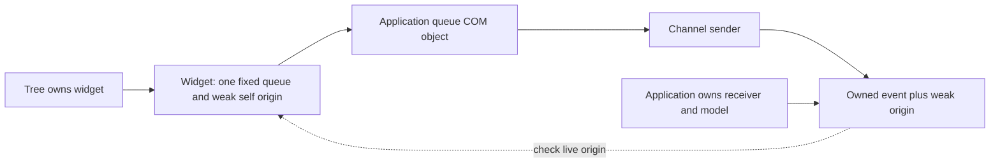
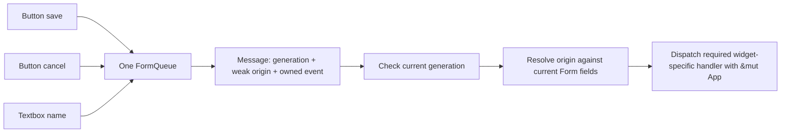

# Typed event queues and weak origins

A producer has one constructor-selected queue for its entire event enum. The
application implements the queue's concrete COM interface and enqueues its own
messages. Widget getters and setters stay on the widget's ordinary interfaces.
There is no attach operation, receiver replacement, event-owner object, or visual
routing language. Application behavior runs after the emitting widget returns.

## Contract and syntax

These are ordinary generic library declarations, not UI-specific IDL syntax:

```rust,ignore
interface IEventQueue<Object, Event> {
    fn post(&mut self, origin: &Object, event: &Event) -> Result<()>;
}
enum EventBinding<Object, Event> {
    Unobserved,
    Observed(ComPtr<IEventQueue<Object, Event>>),
}
class Button: IWidget { /* getters, setters and widget operations */ }
enum ButtonEvent { Activated(Activation) }
factory Widgets {
    fn button(&self, label: &[u8], events: &EventBinding<Button, ButtonEvent>)
        -> Result<ComBox<Button>>;
}
```

`Object` must be an interface/class; `Event` must be a declared value. The IDL
backend checks that the binding names the constructor's returned product as its
origin, that a constructor accepts at most one binding, and that constructors of
the same product agree on the event type. Generics still produce concrete ABI
interfaces and checked value codecs. Neither Rust generics nor channels cross COM.

`post` borrows both arguments for the synchronous call. Generated Rust receives
`ComRef<'_, ButtonAbi>` and `NcValueRef<'_, ButtonEvent>`. Retaining the event
requires `to_owned()`, which uses the existing checked, budgeted value decoder.
Retaining a widget origin's identity requires `origin.downgrade_box()`;
shared service origins use `origin.downgrade()`.

## One concrete application queue

A single object can implement `ButtonEventQueue` and `TextboxEventQueue`. Every
button can share its button projection and every textbox its textbox projection.
The following abbreviated Rust illustrates the application-owned boundary:

```rust,ignore
enum AppMessage {
    Button(WeakComBox<ButtonAbi>, ButtonEvent),
    Textbox(WeakComBox<TextboxAbi>, TextboxEvent),
}
#[com_object(interfaces(ButtonEventQueue, TextboxEventQueue))]
struct AppQueue { sender: std::sync::mpsc::Sender<AppMessage> }
impl ButtonEventQueue for AppQueue {
    fn post(&mut self, origin: ComRef<'_, ButtonAbi>, event: NcValueRef<'_, ButtonEvent>)
        -> Result<(), NcStatus>
    {
        let event = event.to_owned()?;
        neocogi_ui::button::validate(&event)?;
        let message = AppMessage::Button(origin.downgrade_box()?, event);
        let _ = self.sender.send(message);
        Ok(())
    }
}
// TextboxEventQueue::post performs the corresponding typed acquisition.
let app_queue = AppQueue::from_value(AppQueue { sender });
let buttons = app_queue.query::<ButtonEventQueueAbi>()?;
let texts = app_queue.query::<TextboxEventQueueAbi>()?;
let button = ui.widgets().button_with_queue("Save", Some(buttons.as_com_ref()))?;
let textbox = ui.widgets().textbox_with_queue("", Some(texts.as_com_ref()))?;
```

The concrete implementation owns a sender, not the application model or parent
widget. Its methods use `&mut self`. It needs neither `Any`, a callback registry,
nor a `RefCell<Parent>`. Application handlers receive ordinary mutable model
access when they drain their inbox. A receiver must not call widget methods
synchronously during `post`: the emitting widget still holds its exclusive call
gate. Acquiring a weak reference operates only on lifetime bookkeeping.

`*_with_queue` accepts a concrete queue projection and `*_unobserved` selects
permanent non-delivery. IDL emits the ordinary queue trait, checked wire methods,
and producer type association; it emits no callback receiver class. The former
`receiver`, `mapped_queue`, per-event `queue`/`filter_queue`, and sender/mapper
constructor helpers have been removed. Keeping those paths had preserved one
adapter allocation per observed widget and separate compiled specializations per
mapper type in the demos and tools. The concrete application-owned queue is now the only observed path.

An application also chooses its own queue capacity and disconnected/full policy;
COM does not prescribe an unbounded Rust channel.

## Ownership and destruction



Widgets use `ComBox` ownership and cached two-word `WeakComBox` observers.
Dropping the sole owner rejects new calls immediately; admitted calls finish
before destruction. Weak observers have no owning `upgrade`. `borrow()` protects
an ABI argument for one lexical call, and each generated method independently
checks admission. Empty allocation storage survives until the last weak token.
See [exclusive ownership](EXCLUSIVE_WIDGET_OWNERSHIP.md) and
[ABI v13](../crates/com/docs/abi-v13.md) for threading and provider obligations.

There is no `IWidget::close` or independently closed live widget. Widget queues
and private inboxes are ordinary fields destroyed with the value. Generated forms
check weak origin liveness, exact identity and generation before invoking a
current-form handler. Already queued facts are not retracted; applications may
use their captured data after the producer has died.

## Construction and composites

Widget implementations declare `ownership = exclusive` on `com_class` or
`com_object`, then use `into_box_cyclic` / `into_local_box_cyclic`. Their
builder receives a weak origin before publication. Calls during construction
fail; an initialization panic cannot publish the value. A fixed optional typed
queue is an ordinary field. It cannot be installed or replaced after publication,
and unobserved widgets allocate no receiver.

TextArea's private editor posts with the enclosing TextArea identity. Its factory
uses concrete `LocalBox` access to set that origin before publication. Combo's
choice menu remains a shared service with its own semantic popup lifecycle; a
typed bridge forwards with the enclosing Combo's weak origin. Dropping Combo releases its menu. The popup coordinator observes that service
weakly and removes an expired popup during normal reconciliation, without a
fallible destructor callback. Those private construction steps do not
create an application attachment protocol.

Window/popup/menu capabilities remain shared `ComPtr` services with their own
explicit dismissal/removal operations. `WeakComPtr` and `EventPort` remain useful
for those non-widget lifetimes; widgets do not use their separate close state.


## Inspection and custom widgets

The IDL compiler derives the queue identity and reachable event value graph from
the factory signature. The producer does not implement its receiver interface:
inspection must not search the widget's QueryInterface ancestry for that queue.
Independent widget plugins publish this information through `IDesignWidgetCatalog`.
Catalog revision 8 carries `event_queue`, including its exact IID/signature and
public Rust implementation trait path (`rust_trait`). COM validates this binding
path using the same policy as interface and value paths. The designer does not
infer custom Rust trait names from widget names. Designer inspection and construction use the same contract for built-in
and custom widgets; application message types remain private to the application.

## Generated forms

One generated `FormQueue` implements the concrete queue contracts for all emitting
fields. Instances of the same widget type share its corresponding receiver; a
weak origin distinguishes them. A form without events allocates no queue.



`Message.event` is a `QueuedEvent`, with one variant per concrete queue contract.
After checking `slot.accepts(message.generation)`, call
`message.event.resolve(&app.form)?` to obtain an optional widget-specific `Event`.
Then call `event.dispatch(&mut app)?`. Resolution and mutable behavior are separate
so handlers can use their own form fields without a second borrow of the application.
Expired or unrelated origins yield None. Generation checks identify the form
construction attempt; weak lifetime alone does not establish current membership.

The generated `Handlers` trait continues to require one method per emitting
widget, including two distinct buttons. Missing handlers fail Rust compilation.
`bind` resolves fields without changing event ownership. This design uses one
queue allocation per construction attempt and no per-widget mapper allocations.
Each generated `post` validates/acquires its borrowed payload and captures a weak
origin before enqueueing; it never executes application behavior synchronously.

## Verification

The IDL construction fixture crosses actual generated factory and queue thunks,
including permanent unobserved/closed behavior, failed construction, malformed
binding tags, inconsistent event declarations and compile-time rejection of late
attachment and the removed receiver-construction helper. The cargo-neocogi module
integration test scaffolds a contract, runs the owning build script and explicit
generate/build commands, then exercises a shared concrete queue through real
factory and producer calls. Runtime tests use real widget origins and routed input. A concrete
application test implements two queue interfaces on one allocation, verifies FIFO
snapshots and origin identity, then destroys both widgets while retaining their
queued messages. COM tests separately exercise C callers, wrong revisions,
thread-local compile failures, shared promotion races and final value destruction.

Compiled generated-form regressions exercise repeated classes, eventless forms,
custom COM catalogs, raw Rust identifier paths, live input, mutable handlers, and
replacement with retained weak fields from the old generation. Composite regressions verify that
TextArea and Combo messages identify their public object and do not keep it alive.
