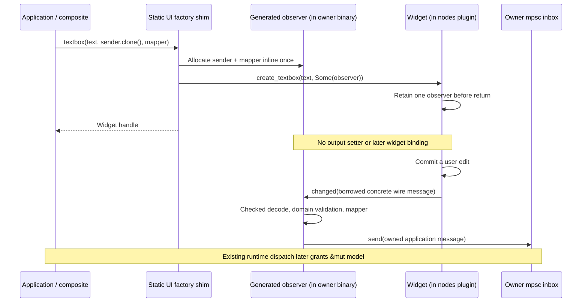
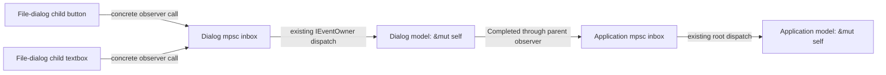

# Widget observers supplied at construction

Built-in observed controls now accept their owner's sender and mapping function
when created. Their IDL declarations generate the observer protocol; the static
Rust facade supplies mpsc transport. A textbox has one observer covering both
`Changed` and `Submitted`, rather than independently installed output receivers.

```rust
use neocogi_ui as ui;
let (sender, messages) = std::sync::mpsc::channel();
let name = ui.widgets().textbox("", sender.clone(), |event| match event {
    ui::textbox::Event::Changed(value) => AppMessage::Name(value.text),
    ui::textbox::Event::Submitted(value) => AppMessage::Submit(value.text),
})?;
```

Here `ui` is the `neocogi_ui` crate alias as well as the existing UI value.
`messages` belongs to the application's existing `Controller<Model>`. Construction
does not introduce an update session, dispatch guard or widget-private queue.

## Generated contract and allocation

An NCIDL producer marked `#[observer]` declares ordinary message outputs. The
compiler synthesizes a concrete observer interface and local event enum:

```rust
// Authored IDL, abbreviated to show the ownership-related declarations.
#[version(2)]
#[observer]
interface Textbox {
    changed: TextChanged;
    submitted: TextSubmitted;
}
// On UiFactory:
fn create_textbox(&self, text: &[u8], observer: Option<&TextboxObserver>) -> Result<Textbox>;
```

The generated `TextboxObserver` methods borrow `NcMessage<TextChanged>` and
`NcMessage<TextSubmitted>`. Their adapter validates and acquires each concrete
message before invoking the local callback with `TextboxEvent`. The producer's
factory retains the optional observer before returning the widget. The compiler
does not infer which factories create a producer or enforce their retention
implementation; built-in factories implement and test that rule explicitly.



Each observed convenience constructor creates one observer allocation, independent of the
number of outputs. The mapper is stored inline; there is no separately boxed
callback, `Any`, local raw callback pointer or per-frame observer creation.
There is still a setup query for the observer projection and a retaining reference
increment in the factory. Posting crosses one observer COM method and decodes an
owned snapshot. Payload copies and mpsc queue blocks can allocate.

Call `ui::textbox::observer(sender, mapper)` when a prebuilt observer is useful,
then pass `Some(observer.as_com_ref())` to `textbox_with_observer`. Several widgets
may explicitly share that observer when they use the same mapping. They still
each have only one destination. Separate convenience calls create separate
observers; cloning a sender shares the inbox, not the observer allocation.
`textbox::filter_observer` can discard selected variants before enqueueing.
`textbox_unobserved` supplies `None` and creates no observer.

Logical widget closure releases its observer reference even while client editing
handles survive. A separately retained observer handle keeps its own captures
alive. Failed construction releases temporary captures. Capturing a producer or
its owning UI in its own observer can form a reference cycle; the examples capture
senders and routing values instead. Mappers run synchronously inside the producer
call and should translate values; model behavior runs when the owner dequeues.

## Composite ownership and named document exports

The file dialog creates its private channel before constructing buttons and
textboxes, passing each child's observer into that child's factory. Row observers
capture the exact native path at creation. Its model consumes those messages and
posts `IFileDialogEvent::Completed` through the observer supplied by its parent.
The observer pattern is the same at both levels.

TextArea supplies its public observer directly to its private text editor;
there is no text-event capability query or forwarding registration. Combo supplies
the core choice-menu observer directly to the choice-menu state; its node header
adds no second event-forwarding observer. Structural containers do not need a
channel simply because they contain children.



Document output names remain configurable after loading. For a node with exports,
the loader constructs one generated `exported_observer()` implementing both the
concrete observer and `INamedOutputs`, and passes the observer to the factory.
The component registers its named-output projection with
`NamedOutputs::export_component`. Public binding replaces a downstream concrete
receiver field on that object, never the widget's observer. Invalid names or
receiver types preserve the previous destination. Delivery adds one COM forwarding
call with the borrowed message, without a name lookup or intermediate owned copy.
Nodes without exported outputs receive no such adapter.

## Scope and linkage

The constructor policy applies to button, checkbox, numeric, list, scrolling,
split and text controls, choice menus and file dialogs. Demos, editors, runtime
fixtures and document construction use it. The UI designer recreates a destination
combo when its captured candidate list changes, so an older queued selection keeps
its original interpretation.

Window, popup and application-menu capabilities still use their existing
per-output `events::bind` API. Unannotated IDL producers retain that policy,
including the independent extension example. No compatibility setter remains on
an annotated widget producer. Hosts and providers must rebuild together for the
changed interface signatures.

This work changes widget event construction. It does not replace
`Controller<Model>`, `IEventOwner`, their scheduler, retirement tickets, or
`LocalCom<T>`. In particular, `LocalCom` still reconstructs local implementation
pointers with unsafe code under the COM borrow gate. This is not a claim that all
local event/controller unsafe code is gone. The new observer/channel layer adds
no handwritten unsafe code; generated COM vtables and codecs reuse the existing
ABI implementation.

Contracts compile as ordinary Rust dependencies. A mapper, sender, generated
observer implementation and private message type compile into the binary owning
that mapper: the executable for application observers, nodes for dialog-private
observers. Widget implementations call concrete observer vtables across the
existing plugin boundary. `libnc_com.so` remains the process COM runtime, with no
new event shared library. Dynamic and monolithic assemblies use the same API.

## Validation and measurements

Workspace unit, integration, compile-fail and documentation tests pass. The final
workspace run used an isolated `CARGO_TARGET_DIR` after the ordinary cache was
removed during an earlier run.

Focused regressions cover a single allocation shared by textbox outputs, no
additional factory allocation when retaining an observer, logical closure with
surviving widget handles, failed construction, rejected malformed/domain-invalid
messages before mapping, and named-export replacement without replacing the
widget observer. Existing nested ownership, retirement and idle-update allocation
tests exercise the unchanged controller path.

The full-demo executable **increases by 304 bytes**, from 195,728 to 196,032.
The complete set of deployed binaries decreases by 4,376 bytes. These are
separate measurements; the package reduction does not imply the executable shrank.

Baseline: `0956c772`, before this branch. Implementation: `02ec88d1`, including the
creation-time migration and demo mapper consolidation. Both dynamic builds used
the same repository/source/build paths, checked-in `cargo-neocogi` driver, Vulkan
variant, `x86_64-unknown-linux-min-size` target, and `min-size` profile. Compiler:
Rust `1.100.0-nightly (bff8e12ff 2026-08-26)`. Sizes below are deployed file lengths,
not resident memory or allocation counts.

| Deployed file | Before bytes | After bytes | Delta |
| --- | ---: | ---: | ---: |
| `libnc_com.so` | 44,904 | 44,904 | 0 |
| `libnc_gfx.so` | 246,024 | 246,040 | +16 |
| `libnc_render.so` | 176,768 | 176,768 | 0 |
| `libnc_skin.so` | 209,368 | 209,176 | -192 |
| `libnc_ui.so` | 200,992 | 200,968 | -24 |
| `libnc_ui_nodes.so` | 301,328 | 296,848 | -4,480 |
| `neocogi-demo-full` | 195,728 | 196,032 | +304 |
| `plugins.txt` | 73 | 73 | 0 |
| **Binaries total** | **1,375,112** | **1,370,736** | **-4,376** |

Asset and theme trees match the baseline by relative path and SHA-256; the plugin
manifest is unchanged. The short library filenames remain in the staged package.

The first migration build produced a 197,544-byte executable (+1,816). Its linker
map contained three specialized slider observer posting thunks and two button
posting thunks. A typed `NumericTarget` enum and common activation-observer helper
reduced these to one of each, saving 1,512 bytes without callback boxing, casts,
`Any`, or mutable routing storage. The remaining +304-byte increase is real.
Generated observer implementations and their concrete vtables reside in the
consumer; grouping outputs and keeping callback captures inline does not promise
smaller executable code for every mapper configuration.

```sh
# Workspace code and generated-contract regressions; documentation examples too.
cargo test --workspace --offline
cargo test --workspace --doc --offline

# Independent no-default-feature contract generation and browser configuration.
cargo check -p neocogi-ui-core-contracts -p neocogi-ui-nodes-contracts --no-default-features --offline
cargo check -p neocogi-demo-full --no-default-features --features webgl --target wasm32-unknown-unknown --offline

# The checked-in driver preserves short library target names.
cargo run -p cargo-neocogi --offline -- build --assembly full --variant vulkan --profile min-size --offline
cargo run -p cargo-neocogi --offline -- build --assembly full --variant vulkan --variant monolith --profile min-size --offline

# Stage real plugin-backed application tests, then run their staged executable.
CARGO_NET_OFFLINE=true NEOCOGI_TEST_BUILD_ONLY=1 scripts/test-demo.sh vulkan
```

The staged Vulkan test runner passes all five tests, including the actual full
application's themes, images, actions and teardown. The measured dynamic min-size
executable also completes a two-frame GPU smoke run from `/tmp`, using
`NEOCOGI_DEMO_FRAMES=2`. ELF inspection confirms its sole NeoCogi `DT_NEEDED`
entry is `libnc_com.so`; the manifest selects the five existing plugins. The
monolithic min-size assembly also builds without a NeoCogi dynamic dependency.
The wasm32 result is a compile check, not a browser runtime test.
