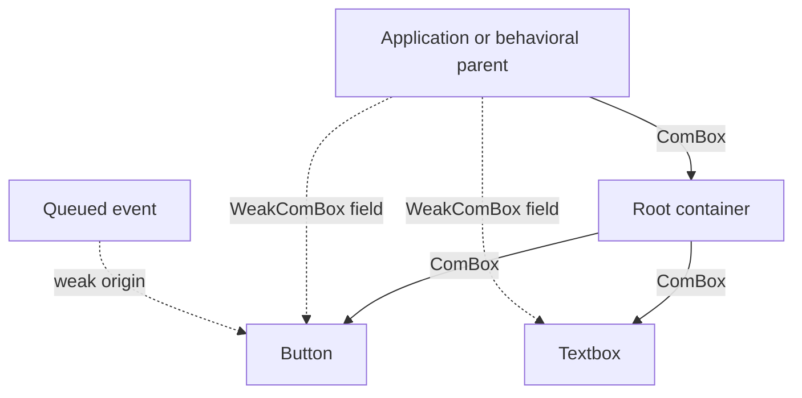
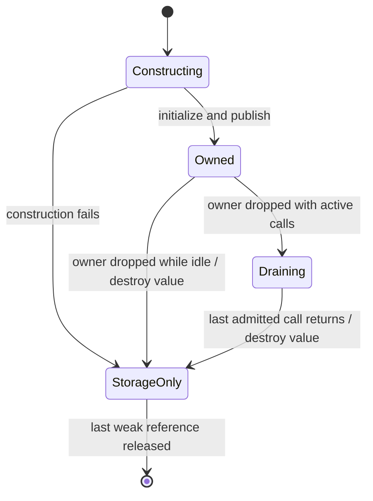

# Exclusive widget ownership and destruction

This document records the agreed replacement for retained closed widgets. It is
an implementation contract; migration status below distinguishes available COM
primitives from consumers still using the previous model.

## Why close existed

Widget factories returned shared `ComPtr` owners. Inserting a control borrowed
it and added another owner in the tree. Application form fields, interface
projections, and loaded-document indexes could therefore retain controls after
tree removal. `IWidget::close` retired event delivery and descendants while
leaving those allocations alive. Getters and setters needed a terminal closed
state. A separate event-port state machine repeated part of that lifecycle.

The issue was ownership, not an inherent requirement of COM or events. The
replacement gives each widget one owner and makes observer references incapable
of extending its resource lifetime. Historical close regressions must become
ownership/destruction regressions when their consumers migrate; deleting their
assertions without testing the replacement is insufficient.

## Ownership follows containers

A factory transfers a `ComBox<WidgetInterface>`. Insertion consumes that owner;
the container owns the child. The application owns a root until it transfers the
root into another owning container. Behavioral parenthood determines event
handling; it does not create an additional owning reference to each descendant.
Generated form fields and lookup indexes use `WeakComBox<ConcreteInterface>`.

A widget can be attached once and cannot be detached for reuse. Removal destroys
its owner and subtree; replacement removes the old subtree and transfers a new
owner. Successful interface selection must borrow or move an existing owner,
never duplicate it. Shared services may continue to use `ComPtr`; exclusive
widgets must reject their retaining protocol, including through ABI arguments.

## Cached weak calls and threading

A weak box stores the canonical control pointer and a validated interface table.
Ordinary calls use that cached table: no interface search, temporary shared
owner, or strong-count increment is required. Generated provider entry points
acquire execution protection before constructing a reference to the value and
use the existing shared-reader/exclusive-writer call gate. Conflicts report
`NC_E_BUSY`; methods do not implicitly wait on a lock.

`ThreadLocal` handles cannot cross threads. `ThreadSafe` requires the provider to
support concurrent calls and destruction on any participating thread. The
initial common implementation uses atomic lifetime bookkeeping for both modes;
thread affinity alone is not evidence that every alias to the allocation is
local, since shared capabilities can be deliberately weakened.

Owner removal atomically rejects new calls. Already admitted calls finish before
concrete destruction, without blocking the removing thread. The last active call
may execute destruction. This execution protection is not an independently
clonable owner. An exclusive method's Rust reference and borrow gate must expire
before its lifetime protection is released.

Weak references keep control storage and provider code available, not widget
resources. Calls after owner removal report `NC_E_CLOSED`, meaning an expired
owner rather than an independently closed live widget. Allocation storage may
remain until the last weak token disappears. Cross-plugin destruction and
storage release always call the allocating provider through the C ABI.

Queued event payloads are already owned facts. Expiring their weak origins does
not erase the payloads; application policy determines whether a fact remains
useful. A queue must not retain an owning back-reference to its widget subtree.

## Scope of removing close

The target is to remove `IWidget::close`, its duplicated event-port lifecycle,
and fallible descendant-close orchestration once containers own `ComBox` values.
Window dismissal and dialog cancellation remain application operations: they may
choose whether to remove an owner and may emit a result before removal. Those
operations must not be confused with a generic widget close state.

Implementation status: COM exclusive owner construction, cached weak dispatch,
concurrent execution protection, and ownership rejection are implemented first.
IDL factory/container transfers and their generated-call regressions are now
implemented. The UI container/form migration remains subsequent work
on this branch. The historical review finding is not marked resolved until that
migration and its tests are complete.
