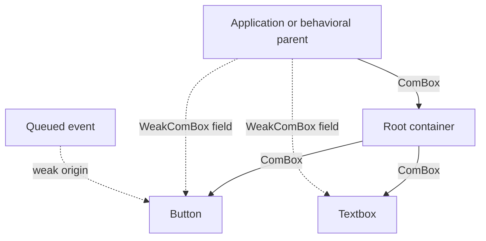
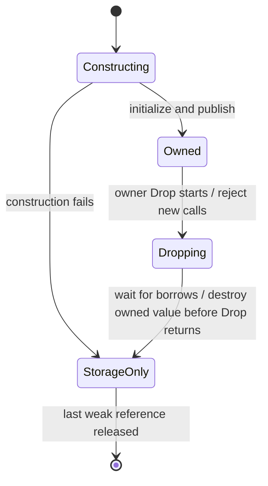

# Exclusive widget ownership and destruction

This document records the agreed replacement for retained closed widgets. It is
the ownership contract shared by COM, UI factories, containers, generated forms,
and independently built plugins.

## Why close existed

Widget factories returned shared `ComPtr` owners. Inserting a control borrowed
it and added another owner in the tree. Application form fields, interface
projections, and loaded-document indexes could therefore retain controls after
tree removal. `IWidget::close` retired event delivery and descendants while
leaving those allocations alive. Getters and setters needed a terminal closed
state. A separate event-port state machine repeated part of that lifecycle.

The issue was ownership, not an inherent requirement of COM or events. The
replacement gives each widget one owner and makes observer references incapable
of extending its resource lifetime. Historical close regressions must become
ownership/destruction regressions when their consumers migrate; deleting their
assertions without testing the replacement is insufficient.

## Ownership follows containers

A factory transfers a `ComBox<WidgetInterface>`. Insertion consumes that owner;
the container owns the child. The application owns a root until it transfers the
root into another owning container. Behavioral parenthood determines event
handling; it does not create an additional owning reference to each descendant.
Generated form fields and lookup indexes use `WeakComBox<ConcreteInterface>`.



A widget can be attached once and cannot be detached for reuse. Removal destroys
its owner and subtree; replacement removes the old subtree and transfers a new
owner. Successful interface selection must borrow or move an existing owner,
never duplicate it. Shared services may continue to use `ComPtr`; exclusive
widgets must reject their retaining protocol, including through ABI arguments.

An `OwnedWidget<I>` facade stores only its `ComBox<I>` (two machine words).
Its editing methods call that same checked client directly. `handle()` explicitly
creates a weak `Widget<I>` for application fields; creating, configuring, and
inserting an otherwise unobserved owner allocates no redundant weak token.
`as_interface()` borrows the actual stored handle, so taking a persistent
observer from an owner requires `downgrade()` or `handle()` explicitly.
`ComBox::query_weak` selects a different observer interface without moving the
owner or allocating a temporary weak token. Facade flag/style queries use this
same checked projection path.

## Ownership is a concrete class policy

Use `#[com_class(Button, ownership = exclusive)]` (or the same option on
`com_object`) for widgets and other unique owners. Shared services use the default
`ownership = shared`. These are separate concrete implementation policies;
an interface does not determine ownership. A class cannot expose both constructor
families. `com_factory` rejects exclusive ownership because factory handles are
shared services.

Shared classes use their existing strong count and borrow gate. Exclusive classes
use one atomic header word for owner presence and reader/writer access, followed
by the weak count and class descriptor pointer. Their generated allocation is one
common header plus `UnsafeCell<MaybeUninit<T>>`; there is no separate call gate or
execution pin. Both kinds of provider-local lease occupy two words. Only C-shaped
records cross plugin boundaries; see [the current core ABI](../crates/com/docs/README.md).

## Cached weak calls and threading

A weak box stores the canonical control pointer and a validated interface table.
Ordinary calls use that cached table: no interface search, temporary shared
owner, or strong-count increment is required. Generated provider entry points
atomically check owner presence and acquire shared/exclusive access before
constructing a reference to the value. Conflicts report
`NC_E_BUSY`; methods do not implicitly wait on a lock.

`ThreadLocal` handles cannot cross threads. `ThreadSafe` requires the provider to
support concurrent calls and destruction on any participating thread. The
initial common implementation uses atomic lifetime bookkeeping for both modes;
thread affinity alone is not evidence that every alias to the allocation is
local, since shared capabilities can be deliberately weakened.

Owner Drop atomically rejects new calls and waits for already admitted calls to
finish. The dropping thread then destroys the value and its owned children before
returning. Borrow release never runs a destructor. The implicit weak storage
reference protects allocation bookkeeping until value destruction finishes.



A method must not destroy its own owner or an ancestor while executing. The UI
checks the actual subtree's borrow state before committing removal and reports
`UI_E_BUSY` on reentry; it does not mark a parent closed first. A widget reports
close intent through its existing parent channel. The parent decides after the
method returns; the runtime does not automatically approve requests. Cross-thread
Drop may wait; it must not hold a resource that the
executing method needs. Completion depends on admitted calls terminating.

Weak references keep control storage and provider code available, not widget
resources. Calls after owner removal report `NC_E_DROPPED`, meaning an expired
owner rather than an independently closed live widget. Allocation storage may
remain until the last weak token disappears. Cross-plugin destruction and
storage release always call the allocating provider through the C ABI.

Queued event payloads are already owned facts. Expiring their weak origins does
not erase the payloads; application policy determines whether a fact remains
useful. A queue must not retain an owning back-reference to its widget subtree.

## Concrete construction access

`LocalBox<T>` is created only by the generated concrete constructor. It permits
initialization through `try_borrow_mut(&mut self)` and transfers its owner through
`into_interface`. `WeakLocalBox<T>` keeps that same compile-time implementation
proof after transfer and exposes only scoped `with`/`with_mut` closures. These
closures cannot return borrowed implementation references or guards. They must
not remove their own owner while executing. Neither is a
foreign downcast API. Composites can initialize their private controls without a
second owner or a `RefCell` around every widget.

A borrowed widget origin can call `ComRef::downgrade_box()` to capture a weak
identity for a queued event. `WeakComBox::is_alive()` is only an observation;
every subsequent method still checks admission, because another thread may
remove the owner between the check and the call.

## Removing the generic close operation

`IWidget::close`, the widget's `Closed` state, and fallible descendant cleanup are
removed. `WidgetState` tracks only `Unmounted | Mounted`; the COM owner determines
whether a value exists. `ChildEditResult` and deferred widget-close queues are
removed too. Child edits return `Result<()>`. Failure leaves the parent's topology
unchanged and returns the original candidate; success publishes the new topology
and drops any removed owner. There is no recoverable destructor status.

The container exclusively owns its `IChildrenEditor`. A retained editor observer
cannot preserve a removed subtree. Layout scopes retain collection identity,
not the owned children; each layout-service operation takes and returns its own
short child transaction. Dropping the editor between service operations therefore
destroys children immediately, even before the parent layout callback returns.
Removal refuses a checked-out collection instead of keeping deferred cleanup.

Rust field destruction releases the complete subtree before parent Drop returns.
An implementation needing live children in its destructor does that work in its
ordinary `Drop`, before Rust drops its child fields. No generic fallible close
protocol is required.

Owning COM methods receive an ordinary `ComBox`. Rejection returns
`Err((status, original_owner))` through every forwarding call; success consumes the
owner. All fallible setup precedes acceptance. Generated ABI code validates inputs
and receiver admission before adopting an owner, and restores the C owner slot on
failure. A rejected ancestor therefore reaches the caller while still alive; the
caller can retry or drop it after the descendant returns. `ComBoxInput` is removed.

Facade insert/replace/window calls return the original typed widget in their error.
`Mountable::with_mount` restores the concrete projection on failure; compiled forms
also restore their unmounted root. No widget is detached after successful mounting.
Bottom-up construction remains supported. See [ABI v16](../crates/com/docs/abi-v16.md)
for multi-input calls and the invalid-success-output contract.

Construction helpers that intentionally abandon rejected candidates need not
restore a concrete interface merely to drop it. The full demo and shared samples
use one `neocogi_ui_samples::append` implementation: its thin generic entry selects
`IWidget`, then a common body uses the parent's generated `LinearClient`. Both
owner and observer parents borrow that same client view without retaining another
handle. Failure drops the returned common-interface owner only after the provider
returns. Applications needing a typed retry continue to use `Widget::insert`;
forwarding COM methods must still return every original owner.

Window dismissal and file-dialog cancellation remain business operations. An
explicit dialog cancellation posts its result while the dialog owner still
exists, then removes the window. Destruction simply disconnects the private inbox
and releases the outbound queue; it does not manufacture a cancellation event
from an expired origin. Facts already posted to an application queue remain there.

Explicit picker close attempts cancellation and window removal independently. A
completion queue error cannot strand the modal. If removal refuses before
committing, the request is idle and close may retry removal without reposting its
outcome. Removal errors take precedence over delivery errors; when removal
succeeds, a delivery error is still returned. There is no `Closed` request state
or optional private receiver: expired COM ownership is the destruction boundary.

Combo's auxiliary popup has a separate menu-service lifetime. The popup
coordinator keeps a `WeakComPtr` to that service, so destroying the header releases
its menu without a fallible call from `Drop`. Normal reconciliation removes the
expired popup. A regression removes the header during synchronous event forwarding
and verifies that the destination queue is released despite the active menu call.

## Application and generated-form usage

```rust,no_run
use neocogi_ui::{Ui, Rect, FlowDirection, CrossSize, LinearEdge, LayoutTrack};
use neocogi_com::NcStatus;
fn example(ui: &Ui) -> Result<(), NcStatus> {
    let button_owner = ui.widgets().button_unobserved("Save")?;
    let mut button = button_owner.handle(); // Weak editing field.
    let mut column = ui.widgets().linear(FlowDirection::TopToBottom, CrossSize::Stretch)?;
    column.insert(0, button_owner, LinearEdge::new(LayoutTrack::Content))?;
    let window = ui.window("Form", Rect { x: 0, y: 0, width: 300, height: 200 }, column)?;
    button.set_label("Save changes")?;
    window.close()?; // Removes the tree's exclusive owner.
    assert_eq!(button.label(), Err(neocogi_com::NC_E_DROPPED));
    Ok(())
}
```

Custom fields call their generated setters through `as_interface_mut()` and
getters through `as_interface()`, without retaining another owner.

A compiled document retains its unmounted root owner until `take_root()` or a
consuming mount moves it into the tree. Its `root()` and node lookups are weak
observers. Dropping recipe metadata after mounting cannot destroy the tree, and
retaining that metadata cannot preserve a removed tree. `ReloadSlot::take_widget`
similarly transfers its stable container once. A failed candidate is destroyed
even when field validation captured weak handles.

## Verification boundaries

COM integration tests exercise unique transfer, expired cached calls, shared-owner
rejection, provider destruction, borrowed access and concurrent call/removal races.
UI tests exercise rejected attachment, retained child editors, replacement,
parent-controlled close intent, scoped local borrows, queue release, dialogs, and
compiled/reloaded forms. UI interfaces remain thread-local; the concurrent guarantee
belongs to explicitly thread-safe COM contracts. Independently built providers
must implement the same ABI version and keep their code loaded through the last
weak token. No claim is made that arbitrary foreign raw pointers are safe.

The COM foundation is committed as `490e24cb`, the IDL transfer contract as
`8667603d`, concrete initialization access as `db15a693`, and the complete UI and
consumer migration as `2cb90ec9`. Fresh verification passed 868 workspace tests
(23 ignored by default), 51 native editor acceptance tests, and the independently
built native extension smoke run. Browser targets and their test code compile;
no browser execution or binary-size measurement is claimed. Commands and scope
are recorded in [widget dispatch verification](WIDGET_EVENT_DISPATCH.md#verification-on-2026-09-29).

## Measured implementation cost

The size correction report records the
matched min-size builds, Cargo Bloat attribution, and remaining cost of admitted
weak calls. Shared services select no execution token; exclusive widgets use a
non-null token and a single-handle facade. The report distinguishes the original
ownership migration from the later removal of its avoidable overhead.

### Parent-controlled removal

A widget must not synchronously destroy its own owner while one of its methods
is executing. It posts typed intent to its behavioral parent's existing channel.
The parent may decline, ask for confirmation, hide, or remove it. A request alone
changes neither visibility nor ownership; an error does not imply approval.
`IWindow::request_close` and the runtime's removal request list are removed.
`IWindow::close` remains the parent's explicit synchronous removal operation.

```mermaid
sequenceDiagram
    participant Child as Child / caption control
    participant Queue as Parent channel
    participant Parent as Behavioral parent
    participant Tree as Owning container / window
    Child->>Queue: post CloseRequested
    Note over Child: Return with ownership unchanged
    Parent->>Queue: receive intent
    alt Decline or await confirmation
        Note over Parent,Tree: Keep widgets alive and visible
    else Approve removal
        Parent->>Tree: remove / close
        Tree->>Tree: Drop owner and descendants
        Note over Tree: Drop completes; weak calls now fail
    end
```

Posting intent does not discard pending private work. Actual removal destroys the
receiver and its remaining messages before returning. Application facts already
posted to the parent channel remain ordinary owned messages.

The file-dialog ABI has no self-destroying `close` method. Its Rust facade obtains
the window, calls `cancel`, and only after that provider call returns calls
`IWindow::close`. Removal errors take priority over completion-delivery errors;
removal is still attempted when completion delivery fails. Foreign applications
use the same sequence of ordinary interface calls.

The subsequent synchronous Drop size analysis
records the preceding ABI v14 implementation, a 7,616-byte deployment reduction and
the removal of one word of exclusive allocation overhead.

The ABI v15 follow-up report records removal of
`ComBoxInput` and automatic close approval, a **3,992-byte deployment increase**,
887 passing workspace tests, and fresh independent/mixed-compiler plugin checks.
It supersedes the earlier reports' current-API descriptions while preserving their
historical measurements.

The latest construction size follow-up shares
construction work after interface selection, avoids restoring discarded candidates'
concrete types, resolves identical owner projections at compile time, and removes
temporary weak projections. It recovers **7,328 bytes** without changing ABI 15 or
these ownership rules: the deployment is **1,504,112 bytes**, **3,336 below** the
pre-returned-owner baseline. Final verification includes **889 passing workspace
tests**, packaged construction regressions and fresh independent/mixed-compiler
plugin checks. The earlier increase is a historical intermediate result.
