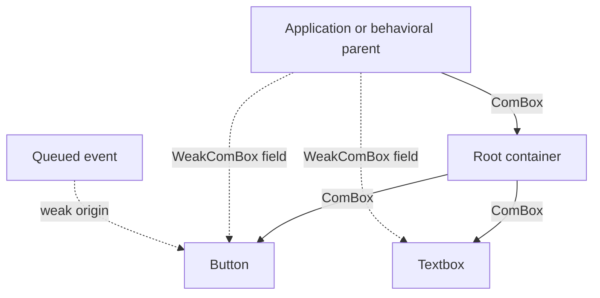
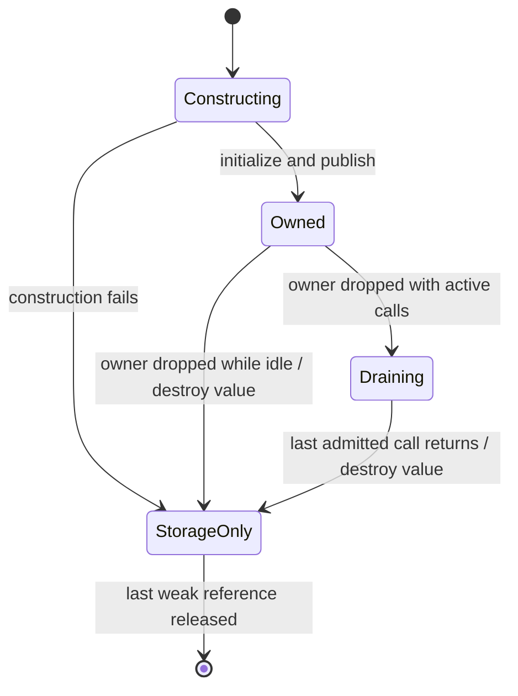

# Exclusive widget ownership and destruction

This document records the agreed replacement for retained closed widgets. It is
the ownership contract shared by COM, UI factories, containers, generated forms,
and independently built plugins.

## Why close existed

Widget factories returned shared `ComPtr` owners. Inserting a control borrowed
it and added another owner in the tree. Application form fields, interface
projections, and loaded-document indexes could therefore retain controls after
tree removal. `IWidget::close` retired event delivery and descendants while
leaving those allocations alive. Getters and setters needed a terminal closed
state. A separate event-port state machine repeated part of that lifecycle.

The issue was ownership, not an inherent requirement of COM or events. The
replacement gives each widget one owner and makes observer references incapable
of extending its resource lifetime. Historical close regressions must become
ownership/destruction regressions when their consumers migrate; deleting their
assertions without testing the replacement is insufficient.

## Ownership follows containers

A factory transfers a `ComBox<WidgetInterface>`. Insertion consumes that owner;
the container owns the child. The application owns a root until it transfers the
root into another owning container. Behavioral parenthood determines event
handling; it does not create an additional owning reference to each descendant.
Generated form fields and lookup indexes use `WeakComBox<ConcreteInterface>`.



A widget can be attached once and cannot be detached for reuse. Removal destroys
its owner and subtree; replacement removes the old subtree and transfers a new
owner. Successful interface selection must borrow or move an existing owner,
never duplicate it. Shared services may continue to use `ComPtr`; exclusive
widgets must reject their retaining protocol, including through ABI arguments.

An `OwnedWidget<I>` facade stores only its `ComBox<I>` (two machine words).
Its editing methods call that same checked client directly. `handle()` explicitly
creates a weak `Widget<I>` for application fields; creating, configuring, and
inserting an otherwise unobserved owner allocates no redundant weak token.
`as_interface()` borrows the actual stored handle, so taking a persistent
observer from an owner requires `downgrade()` or `handle()` explicitly.
`ComBox::query_weak` selects a different observer interface without moving the
owner or allocating a temporary weak token. Facade flag/style queries use this
same checked projection path.

## Ownership is a concrete class policy

Use `#[com_class(Button, ownership = exclusive)]` (or the same option on
`com_object`) for widgets and other unique owners. Shared services use the default
`ownership = shared`. These are separate concrete implementation policies;
an interface does not determine ownership. A class cannot expose both constructor
families. `com_factory` rejects exclusive ownership because factory handles are
shared services.

Shared calls borrow their already retained value through the ordinary call gate.
Exclusive calls first acquire an execution token, then the same borrow gate.
Their Rust lease stores that token directly; shared leases store no token. This
avoids charging every renderer, queue, factory, and other shared service for
widget retirement. The common C control header, interface tables, and cross-plugin
calls retain their existing ABI; provider-local Rust guards never cross it.

## Cached weak calls and threading

A weak box stores the canonical control pointer and a validated interface table.
Ordinary calls use that cached table: no interface search, temporary shared
owner, or strong-count increment is required. Generated provider entry points
acquire execution protection before constructing a reference to the value and
use the existing shared-reader/exclusive-writer call gate. Conflicts report
`NC_E_BUSY`; methods do not implicitly wait on a lock.

`ThreadLocal` handles cannot cross threads. `ThreadSafe` requires the provider to
support concurrent calls and destruction on any participating thread. The
initial common implementation uses atomic lifetime bookkeeping for both modes;
thread affinity alone is not evidence that every alias to the allocation is
local, since shared capabilities can be deliberately weakened.

Owner removal atomically rejects new calls. Already admitted calls finish before
concrete destruction, without blocking the removing thread. The last active call
may execute destruction. This execution protection is not an independently
clonable owner. An exclusive method's Rust reference and borrow gate must expire
before its lifetime protection is released.



Weak references keep control storage and provider code available, not widget
resources. Calls after owner removal report `NC_E_CLOSED`, meaning an expired
owner rather than an independently closed live widget. Allocation storage may
remain until the last weak token disappears. Cross-plugin destruction and
storage release always call the allocating provider through the C ABI.

Queued event payloads are already owned facts. Expiring their weak origins does
not erase the payloads; application policy determines whether a fact remains
useful. A queue must not retain an owning back-reference to its widget subtree.

## Concrete construction access

`LocalBox<T>` is created only by the generated concrete constructor. It permits
initialization through `try_borrow_mut(&mut self)` and transfers its owner through
`into_interface`. `WeakLocalBox<T>` keeps that same compile-time implementation
proof after transfer and uses the ordinary ABI lifetime/borrow gate. Neither is a
foreign downcast API. Composites can initialize their private controls without a
second owner or a `RefCell` around every widget.

A borrowed widget origin can call `ComRef::downgrade_box()` to capture a weak
identity for a queued event. `WeakComBox::is_alive()` is only an observation;
every subsequent method still checks admission, because another thread may
remove the owner between the check and the call.

## Removing the generic close operation

`IWidget::close`, the widget's `Closed` state, and fallible descendant cleanup are
removed. `WidgetState` tracks only `Unmounted | Mounted`; the COM owner determines
whether a value exists. `ChildEditResult` and deferred widget-close queues are
removed too. Child edits return `Result<()>`. Failure leaves the parent's topology
unchanged but destroys the consumed candidate; success publishes the new topology
and drops any removed owner. There is no recoverable destructor status.

The container also exclusively owns its `IChildrenEditor`. A retained editor
observer cannot preserve a removed subtree, and retained read views expire when
that editor is destroyed. An active traversal temporarily owns the child sequence
and drops it when that traversal unwinds if the editor has disappeared.

Rust field destruction releases the idle subtree. There is no universal promise
that the parent's destructor waits for an already admitted child call: that would
block or deadlock a child handler removing its own parent. The parent can be
destroyed first while the child finishes its admitted call. No new call may enter
the removed child. Store cleanup that requires live children in the owning
implementation's ordinary `Drop`, before those child fields are dropped; do not
reintroduce a generic fallible close protocol.

Window dismissal and file-dialog cancellation remain business operations. An
explicit dialog cancellation posts its result while the dialog owner still
exists, then removes the window. Destruction simply disconnects the private inbox
and releases the outbound queue; it does not manufacture a cancellation event
from an expired origin. Facts already posted to an application queue remain there.

Explicit picker close attempts cancellation and window removal independently. A
completion queue error cannot strand the modal. If removal refuses before
committing, the request is idle and close may retry removal without reposting its
outcome. Removal errors take precedence over delivery errors; when removal
succeeds, a delivery error is still returned. There is no `Closed` request state
or optional private receiver: expired COM ownership is the destruction boundary.

Combo's auxiliary popup has a separate menu-service lifetime. The popup
coordinator keeps a `WeakComPtr` to that service, so destroying the header releases
its menu without a fallible call from `Drop`. Normal reconciliation removes the
expired popup. A regression removes the header during synchronous event forwarding
and verifies that the destination queue is released despite the active menu call.

## Application and generated-form usage

```rust,no_run
use neocogi_ui::{Ui, Rect, FlowDirection, CrossSize, LinearEdge, LayoutTrack};
use neocogi_com::NcStatus;
fn example(ui: &Ui) -> Result<(), NcStatus> {
    let button_owner = ui.widgets().button_unobserved("Save")?;
    let mut button = button_owner.handle(); // Weak editing field.
    let mut column = ui.widgets().linear(FlowDirection::TopToBottom, CrossSize::Stretch)?;
    column.insert(0, button_owner, LinearEdge::new(LayoutTrack::Content))?;
    let window = ui.window("Form", Rect { x: 0, y: 0, width: 300, height: 200 }, column)?;
    button.set_label("Save changes")?;
    window.close()?; // Removes the tree's exclusive owner.
    assert_eq!(button.label(), Err(neocogi_ui::UI_E_CLOSED));
    Ok(())
}
```

Custom fields call their generated setters through `as_interface_mut()` and
getters through `as_interface()`, without retaining another owner.

A compiled document retains its unmounted root owner until `take_root()` or a
consuming mount moves it into the tree. Its `root()` and node lookups are weak
observers. Dropping recipe metadata after mounting cannot destroy the tree, and
retaining that metadata cannot preserve a removed tree. `ReloadSlot::take_widget`
similarly transfers its stable container once. A failed candidate is destroyed
even when field validation captured weak handles.

## Verification boundaries

COM integration tests exercise unique transfer, expired cached calls, shared-owner
rejection, provider destruction, borrowed access and concurrent call/removal races.
UI tests exercise rejected attachment, retained child editors, replacement,
self-removal during dispatch, active local guards, queue release, dialogs, and
compiled/reloaded forms. UI interfaces remain thread-local; the concurrent guarantee
belongs to explicitly thread-safe COM contracts. Independently built providers
must implement the same ABI version and keep their code loaded through the last
weak token. No claim is made that arbitrary foreign raw pointers are safe.

The COM foundation is committed as `490e24cb`, the IDL transfer contract as
`8667603d`, concrete initialization access as `db15a693`, and the complete UI and
consumer migration as `2cb90ec9`. Fresh verification passed 868 workspace tests
(23 ignored by default), 51 native editor acceptance tests, and the independently
built native extension smoke run. Browser targets and their test code compile;
no browser execution or binary-size measurement is claimed. Commands and scope
are recorded in [widget dispatch verification](WIDGET_EVENT_DISPATCH.md#verification-on-2026-09-29).
