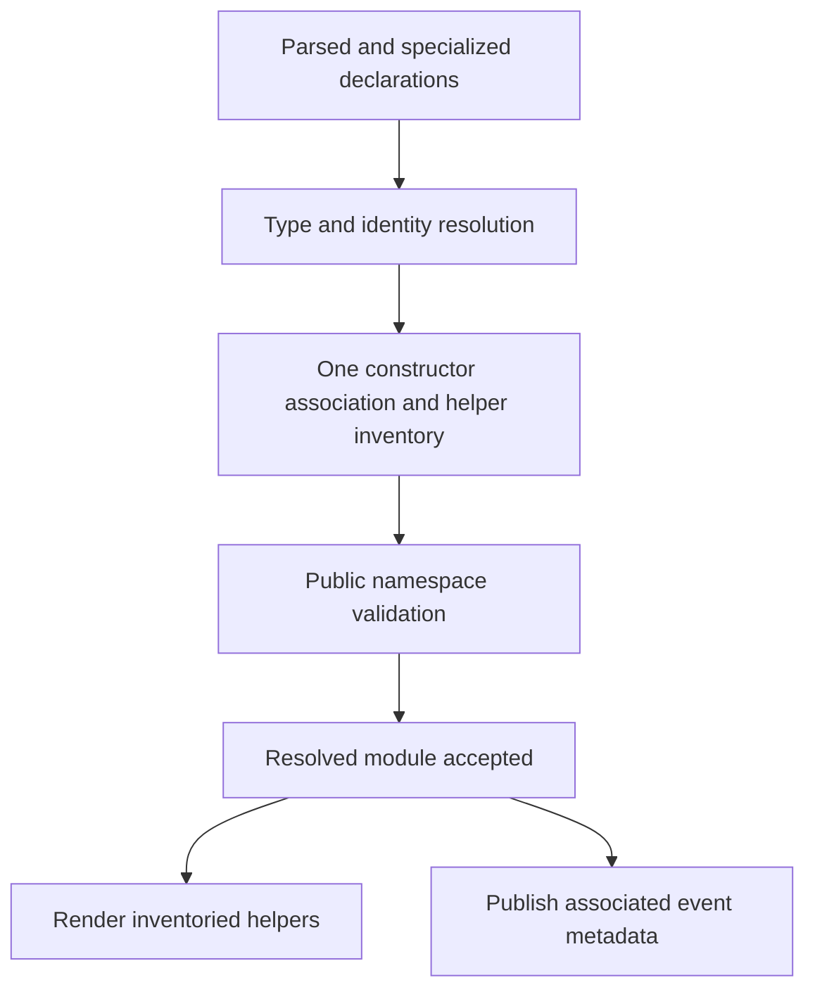

# Resolved constructor associations and public helper names

Constructor helpers belong to IDL resolution. The resolver determines their
meaning and exact names once; name validation, Rust rendering, and event metadata
consume that result. This fixes consolidated audit group 11 (historical generated
COM/IDL review finding 02), where valid IDL could emit duplicate Rust items.

## The contract

A method in the product's declaring module participates when it returns
`ComPtr<Product>`, `ComBox<Product>`, or `WeakComBox<Product>` and accepts a borrowed
`EventBinding<Product, Event>`. Its owner may be an ordinary interface or factory.
The binding is the ordinary `neocogi.com.events.EventBinding` library enum; an
unrelated enum with a similar name does not acquire special meaning.

Resolution checks the library binding's closed shape, its concrete `IEventQueue`
specialization, and its origin/event identities. A participating constructor may
accept only one binding; its origin must identify the returned product. All local
constructors associated with a product must agree on the event identity. Invalid
associations report `EIDL065` with source locations, before Rust generation.

An imported product's association belongs to its declaring module. A downstream
factory cannot change that dependency's generated helpers or published metadata.
An unbound constructor does not add an association. Closed generic interface
products and event values follow the same rules after specialization; comparisons
use resolved identities, not the spelling of imported or qualified type paths.

## Exactly which names exist

For an associated product `Counter`, the resolved inventory is:

| Name | Meaning | Emission condition |
| --- | --- | --- |
| `CounterEventBinding` | Alias for the closed constructor binding enum | Any associated constructor |
| `CounterEventQueueAbi` | Alias for its concrete receiving COM interface | Any associated constructor |
| `CounterEventQueue` | Readable application implementation trait | Any associated constructor |
| `CounterEventQueueVtblFor` | Matching vtable provider re-export required by COM implementation macros | Any associated constructor |
| `CounterEventPort` | Shared-service helper retaining the queue and a `WeakComPtr` origin | At least one associated constructor returns `ComPtr<Counter>` |

`EventSource` and `IDL_INTERFACE.event_queue` use the same resolved association,
including the reachable event value graph. The queue remains a receiver supplied
to construction; it is not a projection implemented by the emitting product.

`EventPort` cannot store `WeakComBox`, so generating its alias for a product with
only exclusive construction was misleading. Exclusive widgets continue to keep
the queue and weak origin directly. No replacement port, runtime discriminator,
new ownership wrapper, or compatibility alias is introduced. If a contract has
both shared and exclusive construction paths, it gets one port alias for the
shared path, regardless of which factory resolves first. A shared constructor
without a binding does not justify that alias.

If the product has no associated constructor, none of these five names is
reserved. The resolver never bans an entire suffix family speculatively.

## Examples and diagnostics

This shared product emits all five names:

```rust,ignore
extern neocogi.com.events;
use neocogi.com.events::EventBinding;
#[version(1)] enum CounterEvent { Changed(u32) }
#[version(1)] class Counter {}
#[version(1)] factory Counters {
    fn create(&self, events: &EventBinding<Counter, CounterEvent>)
        -> Result<ComPtr<Counter>>;
}
```

Adding this declaration or importing a type with this name is rejected:

```rust,ignore
#[version(1)] struct CounterEventBinding { value: u32 }
```

Previously the resolver accepted that module and rustc later rejected two
`CounterEventBinding` items with E0428. Now `EIDL021` identifies the constructor
that creates the alias, the conflicting declaration/import, and the product.
Other emitted helper families and collisions with standard interface companions
receive the same checks, including declarations in different source-part files.

For an exclusively owned product, this is instead valid:

```rust,ignore
// With the same imports, Counter and CounterEvent declarations:
#[version(1)] factory Counters {
    fn create(&self, events: &EventBinding<Counter, CounterEvent>)
        -> Result<ComBox<Counter>>;
}
#[version(1)] struct CounterEventPort { value: u32 }
```

Only the four binding/queue helpers are emitted, so the authored `CounterEventPort`
record has no collision. `WeakComBox<Counter>` results follow the same rule.

## Implementation and history

[Constructor resolution](../crates/com/idl/src/resolve/construction.rs) stores typed
references into the resolved graph and an enum inventory of named helpers. The
[namespace validator](../crates/com/idl/src/resolve.rs) visits each helper's stored
name. [Rust rendering](../crates/com/idl/src/generate/construction.rs) exhaustively
matches those same helper variants. Event metadata reads the stored association
instead of rescanning methods. All of this data lives in the build-time compiler;
it adds no COM object fields, call gates, vtables, or event-delivery operations.
Wire layouts and identity/fingerprint encoding are unchanged.



The history explains why another suffix-list patch was insufficient:

- `a613fbb7`, `fe1cf9a9` and `34a17164` established and expanded generated-name
  reservations for the existing companions.
- `bcd56416` later introduced constructor-derived helpers in the generator.
- `8b21e63a` changed those helpers for concrete queues. `8667603d` recognized
  exclusive constructor results but still emitted the shared-only port alias.
- These independently maintained emission and validation paths explain the
  recurring omission. The new inventory makes the name being rendered the name
  being checked, while resolving constructor semantics once for every consumer.

This is separate from private generated-local hygiene, which prevents authored
parameters from being captured inside a method body. Neither fix replaces the other.

## Verification

[Constructor-name regressions](../crates/com/idl/tests/constructor_names.rs) cover
all five shared helper families against authored and imported names; clashes with
other generated companions; diagnostics across source files; malformed bindings;
consistent and foreign constructors; generic products; absent event associations;
exclusive/weak-exclusive conditional emission; and mixed constructor order.

The [compiled fixture](../crates/com/idl/tests/fixtures/constructor_names.rs)
compiles legal authored helper-like names, implements the readable queue trait
through COM macros, executes a real exclusive factory/event round trip, verifies
owner destruction, and compares exclusive, weak-exclusive and generic receiver
metadata with the generated queue identities. Existing construction tests retain
real shared-port delivery and lifetime coverage.

Run the full IDL suite with `cargo test -p neocogi-idl`. The tool integration is
`cargo test -p cargo-neocogi --test modules`; its scaffolded contract builds and
executes a shared producer/queue application through the normal build script.
Widget nodes, runtime, document loading, designer and the COM plugin example must
also compile against regenerated contracts. This change does not alter the COM
ABI, so it does not require a new compiler-version interoperability protocol.
