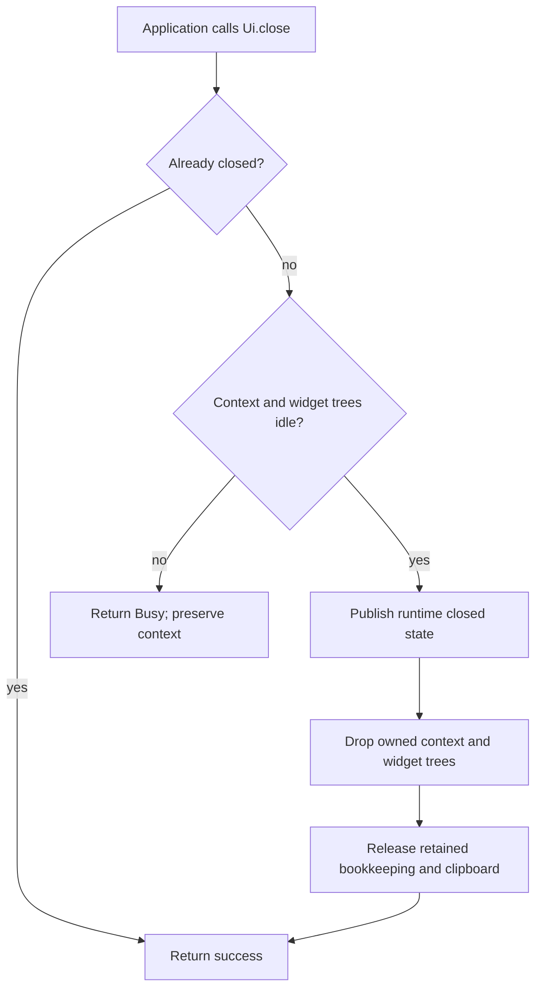

# UI context shutdown and individual window removal

`Ui::close()` / `UiRuntime::close()` is the application's decision to terminate
one UI context. It synchronously drops the context's mounted widget trees and
private runtime resources. It does not run per-window removal operations, post
window/popup lifecycle notifications, or dispatch pending application work.
The process itself may continue, including with other UI contexts.

| Operation | Ownership and notification contract |
| --- | --- |
| `IWindow::close()` while the runtime is live | Remove the selected window family and its widget owners. Publish `WindowEvent::Destroyed` for removed windows. Complete destruction even if posting fails, then report the delivery error. |
| `IPopup::close()` while the runtime is live | Remove the selected popup subtree; ordinary active-popup dismissal can publish `PopupDismissed`. Retain normal delivery error handling. |
| `Ui::close()` | Preflight the complete tree, then consume the runtime context through ordinary Drop. No `Destroyed`, dismissal or synthetic cancellation is emitted by runtime teardown. |
| Final runtime owner Drop | Release the owned context through the same ordinary field destruction, without lifecycle notifications. If explicit shutdown already consumed it, nothing is destroyed twice. |

`IWidget` still has no close operation. Its single `ComBox` owner and normal
field destruction determine widget and descendant lifetime. Logical window
capabilities can remain allocated after their widgets are gone. Their operations
report `NC_E_CLOSED`; calls through weak observers of destroyed widget owners
report `NC_E_DROPPED`. The precise status and concurrent ownership rules remain in
[COM lifetime errors](COM_LIFETIME_ERRORS.md).

## Acceptance and commit boundary

The runtime is thread-local. Before changing terminal state, `close()` acquires
the existing exclusive context transaction and checks every mounted widget tree
for active calls. A busy transaction or widget rejects the operation before
teardown. The transaction restores the live context on failure; no lifecycle
notification or partial destruction is produced by that rejection.

After preflight, shutdown:

1. Publishes the existing runtime closed state before invoking destructors.
2. Takes the checked-out context out of its transaction and drops it. Ordinary
   ownership releases the private compositor, complete surface forest, pending raw
   input, display-list resources and choice-menu controller storage. Widget Drop
   releases descendants, private inboxes, queued payloads and producer-held queues.
3. Clears retained surface identities and weak bookkeeping, releases the installed
   clipboard reference, and returns success. Caller-owned capabilities and immutable
   resources may remain allocated through their own references.

There is no recoverable event-delivery step after commitment because shutdown
never invokes the lifecycle `post` operations. A repeated close returns success
without repeating destruction or notifications. There is no new flag, queue,
observer registration, lock or widget lifetime state machine. Existing COM
admission and synchronous Drop obligations still apply to custom implementations;
this contract does not turn arbitrary user destructor code into fallible cleanup.



## Application requests and queued facts

A final notification is useful when an individual window disappears while the UI
continues to run. The application can update its surviving state. Whole-context
shutdown is a different decision: the application has already accepted teardown
and must settle any required application requests before calling it.

For example, an application that requires a file-picker cancellation completion
should call `picker.cancel()` and process that completion before shutting down the
UI. Runtime shutdown does not manufacture completion results for abandoned
requests. It also does not invoke their pending handlers.

Already-posted application facts remain in application-owned queues. Shutdown
cannot retract them. Pending messages inside a destroyed widget's private inbox
are dropped with that inbox; pending raw UI input is dropped with the context.
An application's independent queue remains under application control.

```rust,ignore
// Individual removal: lifecycle delivery remains part of this operation.
window.close()?;

// Whole-context teardown: the application settles required requests first.
settle_application_requests()?;
ui.close()?; // Drops the trees without posting per-window terminal events.
```

An application dispatcher may call `ui.close()` after widget calls have returned.
That close succeeds, and the enclosing UI update then returns `NC_E_CLOSED` at its
next open-state check. It cannot commit a frame for a terminated context. Later
application messages remain queued and can be handled separately by the
application. A widget attempting to destroy its own active tree still receives
Busy and must leave the decision to its behavioral parent.

## Why the previous implementation was changed

Commit `c79ea351` introduced synchronous lifecycle-error collection and collected
it at individual window/popup and update boundaries. Whole-runtime close reused
ordinary surface removal, generated terminal events, and omitted collection of
one of the resulting error slots. The September 30 audits reproduced an error
returned by `window.close()` but lost by `ui.close()`.

The initial recommendation was to collect that additional error. The subsequent
contract decision explicitly separates ordinary removal from terminal context
shutdown. Therefore the correction removes the notifications themselves from
shutdown instead of expanding error finalization. Individual removal still uses
its existing error policy.

The previous shutdown also retained an empty context and its private compositor
until final runtime release. Consuming that existing owner now releases those
resources immediately. The temporary per-surface list, surface-removal loop and
separate choice-menu clearing helpers are gone. The transaction's sole added
operation transfers its owned value out, leaving the existing optional slot empty.
No alternate tree ownership representation or suppression flag is needed.

## Acceptance coverage

[Real runtime regressions](../crates/ui/runtime/src/runtime/tests/shutdown.rs)
exercise the public generated COM entry points and actual built-in/composite
widgets. They cover independent roots, child windows, hidden dialogs, nested
widgets and an active popup; both accepting and rejecting lifecycle receivers;
queued private-payload destruction; retained weak/strong observations; repeated
close; final runtime Drop; busy rejection and successful retry; immediate private
compositor release; and shutdown from root application dispatch.

The individual-window regression still rejects `Destroyed`, observes the exact
error after destruction, and verifies an unrelated surviving window remains
usable. The terminal tests preserve an earlier application `Hidden` fact while
proving shutdown adds no new lifecycle posts. Before the implementation change,
three of the first five new tests failed: explicit shutdown still posted terminal
facts and retained its private context. Individual removal and final runtime Drop
already matched their intended contracts.

The consolidated open-only audit records implementation revisions and executed
validation when this finding is retired. Historical review text remains evidence
of the earlier contract and is not rewritten as current behavior.
