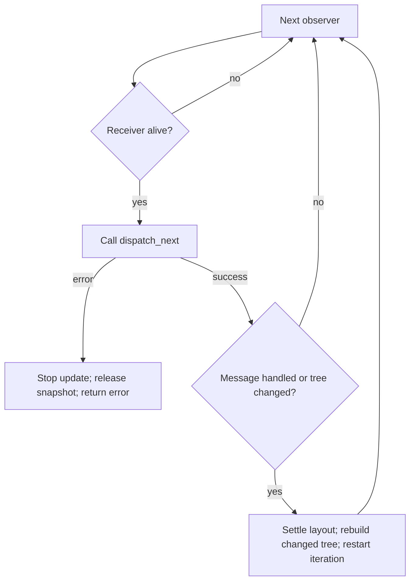

# Widget-owned event dispatch

`IWidget::dispatch_next(&mut self) -> Result<bool>` is the common private-message
operation. A composite owns its model and receiving endpoint directly. Each call
attempts at most one message; `true` means one message was handled and `false`
means no work was available. A handler error consumes the attempted message and
leaves its successors queued. The COM mutable borrow gate protects the same
allocation used for widget editing and rendering.

Ordinary controls forward their constructor-queued events to their behavioral
parent. They do not acquire private queues merely by implementing this method.
The built-in `HostedWidget` helper and application `LeafContent` helper provide
no-op defaults. Independent COM implementations return `Ok(false)` when they
have no inbox; IDL methods remain declarations, without implementation bodies.

Dispatch belongs outside input, layout and paint traversal. A handler can edit
other widgets through COM while using ordinary `&mut self` for its own state.
It must not call back into its own COM projection to obtain another mutable
borrow. Removal of its own subtree is requested through its behavioral parent's
channel; only the parent decides after the active call returns. Posting intent
alone does not discard or stop the widget's remaining private messages.

The sole `ComBox` owner replaces a widget close phase. Dropping it rejects new
calls and destroys its value, private inbox and owned descendants before returning.
A self-removal request runs only after the current handler has returned. Already posted application facts
remain in the application inbox. See [exclusive ownership](EXCLUSIVE_WIDGET_OWNERSHIP.md).

## Ownership and publication

A composite is the mounted widget. FileDialog embeds its Linear root, model and
receiver in one allocation and exposes IWidget, IContainerLayout and IFileDialog.
It mutates its own fields directly and calls distinct children through COM.
`IEventOwner`, its mount/retire methods, `Mount`, and the separate view/controller
wrapper no longer exist. The existing widget mount claim still rejects movement
or second attachment.

The application is not required to be a widget. `IApplicationDispatcher` has
only `dispatch_next`; the runtime borrows it for one update and retains nothing.
The application-owned Controller has ordinary model/receiver fields and no
attachment/retirement phases.

`Loader::compile` constructs a document recipe, weak lookups and one unmounted
root owner. `take_root()` or a consuming mount transfers that owner to the tree.
The metadata can then be dropped independently. Rejected candidates are destroyed
automatically, including when validation retained weak handles.

## Scheduling and cost

The runtime visits actual widgets descendant-first outside traversal and settles
private work before the next application message or raw input event. Topology
changes invalidate the snapshot before its next entry, regardless of the
callback's reported message flag. Its widget references are cleared after each
update, while vector capacity is reused.

`DispatchWidgets` owns that buffer and exposes an iterator, without an external
index or cursor. Each `next()` skips weak observers that have already expired and
yields an owned weak handle for a live receiver. This is the thread-local UI:
iteration does not pin values, and generated COM entry points retain their normal
lifetime/borrow admission checks. Liveness is checked when advancing, not once at
snapshot construction.

The update checks the scratch collection out of its existing cache and passes it
through scheduling with `&mut`. No `RefCell` borrow spans a callback. On success
or any returned error, the update clears all weak entries, restores the buffer for
capacity reuse and marks the next update for a fresh tree collection.

For a yielded receiver the scheduler executes `widget.dispatch_next()?`. Every
handler error stops the update, including `NC_E_DROPPED` from an expired dependency
and `NC_E_CLOSED` from a closed service. Neither status identifies which object
failed. A dequeued message remains consumed; its successors, later widgets,
application messages and unattempted raw input wait for a later update. No partial
frame is committed and no already-performed handler mutation is rolled back.
See the [lifetime error contract](COM_LIFETIME_ERRORS.md) for exact status meanings.

After a handled message or a topology change, iteration stops so layout can settle
and a new pass can begin. A changed tree is rebuilt first; merely skipping expired
entries would miss newly inserted widgets. A handler that changes another idle
subtree and then fails still propagates its error. The changed tree survives and
the next update rebuilds from it.

The diagram describes a pass while entries remain. Exhausting the iterator follows
the ordinary outer scheduling rule: settle any reconciliation work, otherwise
attempt the next application message.

Every ordinary leaf therefore incurs a no-op COM dispatch call during a sweep.
This is an explicit simplicity tradeoff: there is no second capability query,
registration table, per-widget delivery ticket or readiness-notification system.
Binary size and frame-time improvements are not claimed without measurement.

Runtime dispatch snapshots contain weak handles and cannot retain removed values.
Owner Drop rejects new calls and destroys the complete owned value before returning.
Thread-local removal preflights the existing subtree borrow state and returns Busy
if it would recursively destroy an executing method. A widget posts close intent
to its existing behavioral parent channel. Only the parent decides whether and
when to remove it. Neither intent nor a returned error authorizes removal;
explicit edits already completed inside a failing handler remain committed.
The runtime has no special removal-request queue. Weak local construction
access uses scoped closures instead of escaping guards. ThreadSafe COM Drop waits
for concurrent admitted calls, then destroys on the dropping thread.

See the [event guide](../crates/ui/runtime/docs/EVENTS.md) for error semantics,
work budgets, compiled-form lifetime, and application examples, and
[finding 09](COM_UI_ADVERSARIAL_REVIEW_2026-09-26.md#09-ieventowner-means-both-behavior-and-a-lifetime-holder--fixed)
for the superseded design and its history.

## Verification on 2026-09-29

After the exclusive-ownership migration (`2cb90ec9`):

- `cargo test --workspace --offline --no-fail-fast`: 868 passed, 23 ignored,
  no failures.
- Offscreen designer and theme-editor library suites with monolith/embedded assets,
  ignored acceptance tests enabled and the live-edit benchmark excluded: 33 and
  18 passed. These runs include independently built custom-catalog discovery.
- `SDL_VIDEODRIVER=offscreen scripts/test-extension.sh glow`: independently built
  shared plugins loaded, and extension/COM smoke scenarios passed.
- WebGL test-target compilation for the full demo, UI designer and theme editor
  on `wasm32-unknown-unknown`: passed. This is compilation, not browser execution.
- Changed Markdown link/fence validation and `git diff --check`: passed.

The browser compilation check covers its download/export dialogs and preview test
harness, which now transfer owners into windows and retain only weak editing
handles. The native popup regression removes a combo during event forwarding and
checks that its queue is released without a fallible close callback. No binary-size
or frame-time improvement is claimed by these functional checks.

## Iterator and failure regressions

The September 30 review traced the status suppression to `2cb90ec9`, which replaced
strong dispatch snapshots with weak observers. Weak snapshots correctly stopped
retaining removed widgets, but the scheduler used a method error as an inferred
lifetime check. Separating status names alone did not fix live `CLOSED` errors.

The current regression suite covers:

- Expiry before and between iterator advances, live ordering, weak-only results,
  and scratch capacity reuse.
- Real mounted leaves and composites returning `CLOSED`, `DROPPED`, or an ordinary
  invalid-argument error; successors and application work wait until retry.
- A live handler accessing a genuinely destroyed widget through generated COM.
- Removing another subtree and then failing; its queued work is destroyed and
  retry uses the changed tree without replaying the failed message.
- Queued textbox input staying untouched until the failed dispatch is retried.
- Existing child-first delivery, callback insertion/removal, work-budget limits,
  reentrancy rejection and warmed idle-allocation checks.

These changes add no dispatch ticket, per-widget active flag, new close phase or
second queue. The older verification section above remains historical evidence.
