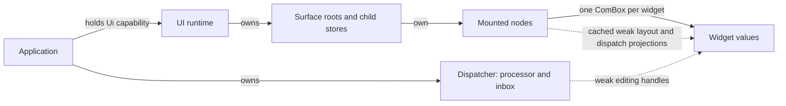
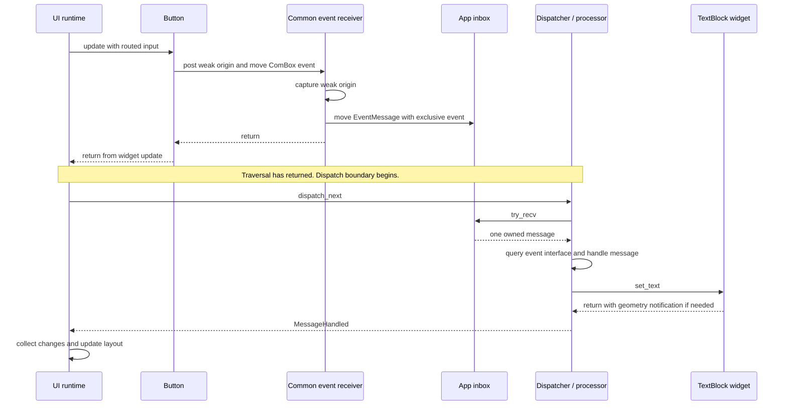
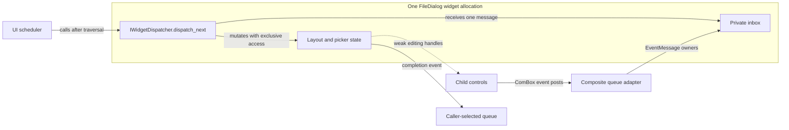
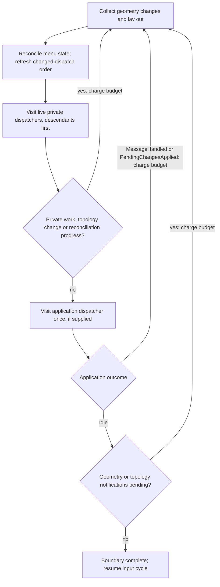

# Widget and event architecture

NeoCogi combines a **retained widget tree** with **COM event inboxes and deferred
message processing**. Widgets own control state, the UI runtime owns routing and
layout, and the application owns its behavior and inbox. A composite widget can
also own behavior and a private inbox.

The behavioral part resembles an actor's mailbox: one owner receives a message
and changes its state through exclusive mutable access. Delivery runs
synchronously on the UI thread under the runtime's scheduler. There is no task or
thread per widget. Applications can organize their domain state however they
choose; `MessageProcessor` describes message handling, without prescribing an MVC
model/controller split.

This document explains how the pieces fit together. The linked
[ownership](../contracts/EXCLUSIVE_WIDGET_OWNERSHIP.md),
[event queue](../contracts/CLASS_EVENT_STREAMS.md), and
[dispatch](../contracts/WIDGET_EVENT_DISPATCH.md) contracts define their detailed
API obligations. The [component guide](COMPONENTS.md) describes provider and
deployment boundaries.

## The objects and their responsibilities

| Object | Owns or does |
| --- | --- |
| Concrete widget | Control state and algorithms; `IWidget` update/paint and one leaf or container layout role. Built-ins and independent plugins use the same protocols. |
| Retained node | The widget's sole `ComBox` owner, geometry, invalidation, cached layout/dispatch projections and, for containers, authenticated child storage. |
| Surface forest | Window, dialog and popup relationships, widget roots, visibility, focus and input routing policy. |
| Event receiver | Implements the common `IEventReceiver`, acquires a weak origin and moves the exclusive COM event to its chosen inbox. |
| `Dispatcher<Processor>` | Owns the application's `MessageProcessor` and its receiving endpoint; exposes `IApplicationDispatcher` to the scheduler. |
| Behavioral composite | A widget allocation containing its own state and private receiver; exposes optional `IWidgetDispatcher` alongside its widget/layout interfaces. |

The core provider implements the retained runtime. The nodes provider implements
concrete controls and standard composites. Mounting authenticates the widget's
host and discovers its capabilities once; ordinary traversal uses the cached
projections. Concrete class identity does not select a special runtime path.

## Widget ownership and editing

Construction returns one exclusive `ComBox` owner. Inserting into a container or
creating a window transfers that owner into the retained tree. A rejected transfer
returns the original owner. After successful mounting, application fields retain
`WeakComBox` editing handles. Their methods still perform normal lifetime and
borrow checks.

Solid arrows describe ownership or a retained capability; dashed arrows observe
widget values. The application dispatcher is owned independently of the tree and
is only borrowed for an update. A weak editing handle or scheduler snapshot
cannot keep a removed widget alive or become a second owner.

Containers own semantic edge policy, such as grid spans or linear tracks. Their
authoritative child stores own the descendant nodes. The runtime derives layout
and routing from that tree; an application's collection of editing handles is
only a way to address selected widgets.

Logical windows and menus use shared `ComPtr` service lifetimes. A surviving
window capability can report that its surface has closed even after the owned
widgets have been destroyed. Shared service ownership and exclusive widget
ownership serve different purposes.

## Raw input, semantic events and private messages

Three different values participate in a typical interaction:

| Value | Example | Owner and destination |
| --- | --- | --- |
| Raw UI input | Pointer press, key transition, UTF-8 text | The runtime queues copied input and routes it using current focus, capture, modality and geometry. |
| Semantic widget event | `ComBox<IEvent>` exposing `IActivatedEvent` | The widget moves its captured event to its constructor-selected receiver. |
| Inbox message | `EventMessage`, optionally wrapped with a reload generation | The inbox owns the COM event and weak origin until its handler processes it. |

An observed widget has one fixed receiver. The `*_with_queue` constructors
select it; `*_unobserved` selects permanent non-delivery. Every widget can share
the same `IEventReceiver` projection. The destination establishes the behavioral
recipient; events do not automatically bubble through visual ancestors.

`post` borrows the weak origin and transfers a `ComBox<IEvent>`. The receiver
captures that identity and moves the exclusive event into its inbox. The event
stays a COM object until handling; no producer-side conversion to an application
enum is needed. Handlers query derived event interfaces and read immutable
getters. Event interface discovery
returns `None` on a type miss and preserves actual ABI/provider errors.

This example has no private composite work. When such work exists, the scheduler
processes it before visiting the application dispatcher. The
[executable button walkthrough](../../crates/ui/api/docs/button_events.rs)
shows the actual queue, processor, construction and `update_with_events` calls.
Its [runtime test](../../crates/ui/runtime/src/runtime/tests/documentation.rs)
drives real keyboard input and destruction through those exact example sources.

The facade's `Dispatcher` uses a Rust `mpsc::Receiver`, but channel types and
private message enums stay within the owning binary. The COM boundary carries
one `IEventReceiver` interface, an exclusive event capability and a checked weak-origin value. An
independent queue implementation chooses its own capacity and delivery-failure
policy.

## Declaring and handling outputs

Each producer lists its event interfaces with `#[events(...)]`. The compiler
validates their immutable getters and exposes the same shape as authoring metadata.
The designer displays event interface names and getter fields. It does not rebuild
their meaning from constructor arguments or native enum variants.

Applications use `events::channel()` and query concrete event interfaces in their
handlers. Reloadable documents can use `document_receiver(generation, sender)` and
`EventBindings::all`; `DocumentEvent::event_for(slot, key)` authenticates the current
attempt and widget before the handler queries an event. Optional generated `Form`
fields simplify widget lookup. No generated event dispatch code is required.

## Behavior inside a composite

A passive button or layout container needs no private dispatcher. A component
such as `FileDialog` needs to interpret its children's events before reporting a
result to its caller. It therefore owns its layout, picker state and receiving
endpoint in the same exclusive widget allocation.

The arrows show message flow and local access. The surrounding retained tree
still determines widget ownership. `FileDialog` changes its own fields through
ordinary Rust mutable access and calls distinct children through COM. Its
`IWidget`, layout and dispatcher projections share one mutable admission gate.
Calling back through its own COM projection would attempt to reenter that gate.

The current private operation is
`IWidgetDispatcher::dispatch_next() -> Result<bool>`: it attempts at most one
message, with `true` indicating handled work and `false` indicating idle. The
application operation instead returns the explicit `ApplicationDispatch` enum
described below. Passive widgets expose no private dispatcher and receive no
empty-inbox calls. Custom leaves can opt in through `DispatchingLeafContent`.

See the [FileDialog implementation](../../crates/ui/nodes/src/dialogs.rs) and
[custom leaf adapter](../../crates/ui/api/src/leaf.rs) for these two forms of
widget-owned behavior.

## Scheduling one update

`Ui::update_with_events(size, dispatcher)` borrows the application's dispatcher
for that call. `Ui::update(size)` runs the same widget/input machinery without an
application dispatcher; application messages can remain queued until a later
eventful update.

The update first synchronizes geometry and enters a dispatch boundary **before
the first queued raw input**. It then processes one input and its eligible widget
updates, releases traversal state, and enters the boundary again. If no input is
queued, it performs one ordinary eventless widget update and another boundary.
Only a successful complete cycle publishes a renderable geometry commit.

At each dispatch boundary:

The diagram shows successful scheduling; errors and budget exhaustion return to
the caller immediately. Within a private pass, a handled message or a topology
change ends iteration so layout and descendant work are reconsidered. Child
surfaces run before their parents, with newer unrelated surface siblings visited
first. Selection includes hidden mounted trees, even though ordinary input and
paint have visibility eligibility rules.

The dispatch buffer contains weak observers collected from the actual tree.
Iteration skips expired receivers, and topology changes trigger recollection
before using the next entry. Entries are cleared after every update, including
failed updates; allocation capacity is reused. There is no separate ready-mailbox
registry. Consequently, a positive private-dispatcher count can require polling
idle receivers; the zero-count path skips collection and private calls.

`IApplicationDispatcher::input_boundary` brackets each consumed input with Begin
and End outside traversal borrows. All dispatch caused by that input precedes
End; End is attempted on failure too. These hooks record ownership facts only,
without geometry edits or more raw input. Native polling may run ahead, so a
deferred consumer retains the markers in the same FIFO as its original COM
events and stamps each decoded command before consuming later markers. The
[theme-editor contract](../contracts/THEME_EDITOR_TRANSACTIONS.md) specifies its
pointer/keyboard Undo groups. Eventless work has no input scope.

One shared budget bounds private work, application work, reconciliation and
consumed input scopes with application bookkeeping across
the complete update. Exhaustion returns `UI_E_EVENT_LIMIT` before another dequeue.
Reaching the exact limit also returns that error, even if the last message emptied
an inbox: the runtime cannot establish that fact without another visit.

## Applying deferred application changes

The [application dispatcher](../../crates/ui/api/src/events/dispatcher.rs) calls
`MessageProcessor::handle` to interpret one private message. A processor can accumulate
work that should be published together, such as a preview revision after several
editor commands. When its receiver is empty or disconnected, `Dispatcher` calls
`MessageProcessor::apply_pending_changes` under the same mutable gate.

| Dispatcher action | Processor result | Runtime-visible result |
| --- | --- | --- |
| Receive and successfully handle one message | `Ok(())` from `handle` | `ApplicationDispatch::MessageHandled` |
| Visit an empty inbox and consume pending work | `ApplyOutcome::ChangesApplied` | `ApplicationDispatch::PendingChangesApplied` |
| Visit an empty inbox with nothing to apply | `ApplyOutcome::NothingPending` | `ApplicationDispatch::Idle` |

The default pending-change hook returns `NothingPending`. An implementation
reports `ChangesApplied` only after consuming real pending work. That result can
mean it posted a child's private message, even when it changed no geometry. The
scheduler must therefore revisit children and layout before later input.

This hook can run before the first input and after each input, several times in
one update. It is an empty-inbox boundary, not a once-per-frame rendering hook or
a guarantee that an entire native input batch has completed. Repeated idle visits
must stop producing work. Preview rendering and other native rendering occur
after the completed update.

Geometry has its own publication protocol: committed setter changes retain a
sticky `take_change` marker and notify `IWidgetHost::mark_geometry_changed`.
Returning a message-work outcome does not replace that notification. The runtime
also reconciles notifications after an `Idle` application visit. See
[pending-change regressions](../../crates/ui/runtime/src/runtime/tests/pending_changes.rs)
and [geometry dispatch regressions](../../crates/ui/runtime/src/runtime/tests/dispatch_geometry.rs).

## Runtime storage and callback access

The current implementation has three internal types with distinct jobs:

| Type | Responsibility |
| --- | --- |
| `Runtime` | Public COM identity and UI entry points; holds `Rc<RuntimeStorage>`. |
| `RuntimeStorage` | Stable internal storage and admission state; window capabilities observe it weakly. Holds the context slot, construction services and dispatch scratch buffer. |
| `RuntimeContext` | The engine state moved into a phase transaction: surface forest, queued raw input, compositor/resources and menu coordination. |

The context slot is currently `RefCell<Option<RuntimeContext>>`.
`ContextTransaction` takes the context out, releases the `RefCell` borrow, and
returns it on ordinary completion or error. A competing context operation finds
the slot empty and receives Busy. The separate update guard prevents a nested
update throughout the whole cycle.

Before calling a message handler, the runtime returns the context to its slot and
releases traversal ownership. The handler can then use ordinary window or tree
editing operations, each with its own short transaction. The widget's or
application dispatcher's own mutable COM gate still protects the active handler.

These are implementation boundaries, not three application layers. The
`WeakLocalCom` foundation exists, but replacing this storage arrangement or boxing
The source is [runtime.rs](../../crates/ui/runtime/src/runtime.rs) and
[runtime_context.rs](../../crates/ui/runtime/src/runtime_context.rs).

## Failure, removal and rendering boundaries

A handler error consumes the attempted message and stops the update. Successors,
later application work and unattempted raw input remain queued. Already committed
edits remain visible to a retry; the runtime does not roll them back or publish a
partial successful frame. A live handler's `NC_E_DROPPED` or `NC_E_CLOSED` can come
from a dependency, so the scheduler propagates it instead of treating it as proof
that the receiver disappeared.

Removal drops the widget's unique owner, descendants and private inbox
synchronously. A widget requests its own removal by sending intent to its
behavioral parent; the parent decides after the active call returns. Removing a
currently executing subtree is rejected with Busy. Facts already sent to the
application's independent inbox survive removal. Their consumer decides whether
an expired origin makes the fact stale; `DocumentEvent::event_for` additionally checks
[reload generation and current field identity](../contracts/RELOAD_GENERATION_IDENTITY.md).

`IWindow::close()` removes an individual window family and publishes its lifecycle
facts. `Ui::close()` terminates the context and drops its trees without dispatching
pending work or manufacturing window/dialog completion events. Applications finish
required requests before choosing [whole-context shutdown](../contracts/UI_RUNTIME_SHUTDOWN.md).

Rendering observes a completed update. Stale geometry requires another update
before frame acquisition. Paint can maintain presentation caches under its
mutable call, but cannot perform semantic geometry edits. Successful paint records
a display list for GFX composition and renderer submission. This keeps input,
behavior, geometry publication and native rendering in an explicit order.

For implementation details and existing regression coverage, follow the
[runtime architecture](../../crates/ui/runtime/docs/ARCHITECTURE.md),
[event guide](../../crates/ui/runtime/docs/EVENTS.md),
[dispatch error tests](../../crates/ui/runtime/src/runtime/tests/dispatch_errors.rs),
and [widget lifetime tests](../../crates/ui/runtime/src/runtime/tests/widget_dispatch.rs).
