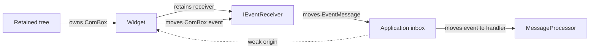
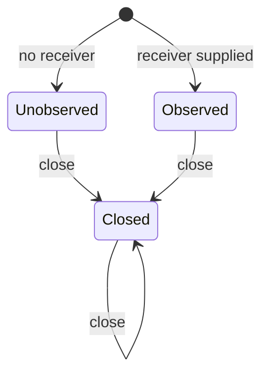

# Constructor-bound events and weak origins

Every observed producer retains one `IEventReceiver` selected before publication.
All producers use that same receiver interface. Each post transfers an immutable
`ComBox<IEvent>` and captures a weak source identity. The complete wire and
ownership contract is [COM event objects](UI_EVENT_INTERFACES.md). Ordinary UI
widgets use [owner-scoped origins](WIDGET_EVENT_ORIGINS.md): their existing host
supplies the current weak source, without a stored self-reference.

## Construction

These are ordinary IDL declarations:

```rust,ignore
interface IEvent {}
enum EventOrigin {
    Widget(WeakComBox<IUnknown>),
    Service(WeakComPtr<IUnknown>),
}
interface IEventReceiver {
    fn post(&mut self, origin: &EventOrigin, event: ComBox<IEvent>) -> Result<()>;
}
enum EventBinding {
    Unobserved,
    Observed(ComPtr<IEventReceiver>),
}
```

`EventBinding` has no type parameters. It chooses the delivery policy only.
The producer advertises its event interfaces with `ui_event_sources!`; constructors
do not infer metadata or generate product-specific helpers. See
[advertised event interfaces](UI_EVENT_METADATA.md).

## One common application inbox

```rust,ignore
let (queue, messages) = neocogi_ui::events::channel();
let button = ui.widgets().button_with_queue("Save", Some(queue.as_com_ref()))?;
let textbox = ui.widgets().textbox_with_queue("", Some(queue.as_com_ref()))?;
// Dispatcher receives EventMessage; each message owns its ComBox<IEventAbi>.
let app = Dispatcher::into_local(Dispatcher::new(processor, messages));
```

A handler can query `message.query::<ITextChangedEventAbi>()?` and call the
returned projection's `text()` and `cursor()` methods. Unsupported interfaces
return `None`; revision mismatches and provider failures remain errors. Rust
handlers use `message.origin.widget::<TextboxAbi>()?` to query the weak origin
separately. No per-form generated receiver code is needed.

Applications needing an envelope, such as a reload generation, implement the one
`IEventReceiver` interface. `EventMessage::capture` acquires the weak identity and
moves the event. A failed post must return the same exclusive event owner. The
standard channel returns `NC_E_CLOSED` and that owner when its inbox disconnects.
Other receivers choose their capacity and error policy.

## Ownership and scheduling



The widget captures its event after committing state. Posting does not execute
application behavior or borrow the emitting widget's state. The scheduler invokes
the handler after traversal returns. A failed post does not roll back committed
widget edits. Producer convenience methods drop a rejected snapshot after
reporting its status; a caller using the raw receiver API can retain or retry it.

An ordinary exclusive widget uses the runtime's owner-scoped origin and releases
its destination when its sole owner is destroyed. Weak projections cannot acquire ownership.
A shared-service `EventPort` additionally has a terminal close state:



Unobserved producers construct and discard snapshots directly. Observed shared ports reject an
expired source with `NC_E_DROPPED`. Closed ports retain no queue or origin and
reject posts with `NC_E_CLOSED`. No attachment, replacement or reopening operation
exists. Posting through a shared port temporarily pins the source; the queued
message still contains only its weak identity.

FileDialog follows the same concrete-owner rule for acceptance and cancellation.
An active request hides its modal and commits Idle. Only the successful hide
operation authorizes that commit; a failed snapshot observation cannot replace it.
A refused hide keeps the request Active
and constructs no outcome. Window notification errors may follow a committed
visibility change, so this does not promise visibility rollback on every error.
After a successful hide and Idle commit, it constructs one completion
snapshot and posts or drops that owner. An already Idle request has no new
completion occurrence. Failure while hiding leaves the request Active; a
construction or delivery failure after the Idle commit never reactivates it.
The request's direct `post(event)` transports an existing owner and does not
change request phase or decide whether its event should be constructed.

Queued event data survives source destruction. Consumers decide whether source
expiry makes a fact irrelevant; file completion may remain useful. Document receivers additionally support [reload generation and current field identity](RELOAD_GENERATION_IDENTITY.md)
before event queries. The shared library receiver transports the same COM event and
adds only the construction attempt's generation.

The [executed button walkthrough](../../crates/ui/api/docs/button_events.rs),
[widget architecture](../architecture/WIDGET_EVENT_MODEL.md), and
[dispatch contract](WIDGET_EVENT_DISPATCH.md) show the complete scheduling path.
