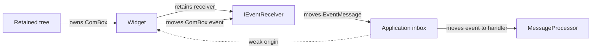
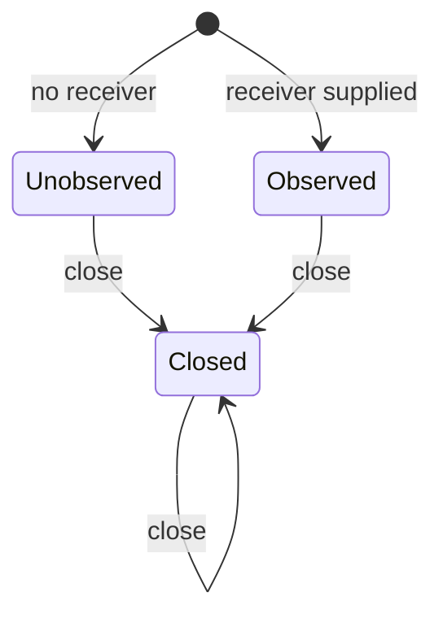

# Constructor-bound events and weak origins

Every observed producer retains one `IEventReceiver` selected before publication.
All producers use that same receiver interface. Each post transfers an immutable
`ComBox<IEvent>` and captures a weak source identity. The complete wire and
ownership contract is [COM event objects](COM_EVENT_INTERFACES.md).

## Construction

These are ordinary IDL declarations:

```rust,ignore
interface IEvent {}
enum EventOrigin {
    Widget(WeakComBox<IUnknown>),
    Service(WeakComPtr<IUnknown>),
}
interface IEventReceiver {
    fn post(&mut self, origin: &EventOrigin, event: ComBox<IEvent>) -> Result<()>;
}
enum EventBinding<Object, Event> {
    Unobserved,
    Observed(ComPtr<IEventReceiver>),
}
```

The binding's type arguments describe the producer and its optional native event
representation for compiled handlers and authoring metadata. They do not select
another receiver ABI. `Object` must be an interface/class; `Event` a declared
value. Resolution requires the origin to match the constructor's returned product,
accepts at most one binding per constructor, and requires associated constructors
to agree on the native event type.

IDL generates `ProductEventBinding` and the `EventSource::Event` association.
Shared `ComPtr` construction also generates `ProductEventPort`. It generates no
per-product queue trait, queue ABI alias, or queue provider. See the
[constructor naming contract](IDL_CONSTRUCTOR_NAMES.md).

## One common application inbox

```rust,ignore
let (queue, messages) = neocogi_com::events::channel();
let button = ui.widgets().button_with_queue("Save", Some(queue.as_com_ref()))?;
let textbox = ui.widgets().textbox_with_queue("", Some(queue.as_com_ref()))?;
// Dispatcher receives EventMessage; each message owns its ComBox<IEventAbi>.
let app = Dispatcher::into_local(Dispatcher::new(processor, messages));
```

A handler can query `message.downcast::<ITextChangedEventAbi>()?` and call the
returned projection's `text()` and `cursor()` methods. Unsupported interfaces
return `None`; revision mismatches and provider failures remain errors. Rust
handlers may instead use `message.widget::<TextboxAbi>()?` to read the native
payload while the message continues owning its COM event. Neither approach needs
per-form generated receiver code.

Applications needing an envelope, such as a reload generation, implement the one
`IEventReceiver` interface. `EventMessage::capture` acquires the weak identity and
moves the event. A failed post must return the same exclusive event owner. The
standard channel returns `NC_E_CLOSED` and that owner when its inbox disconnects.
Other receivers choose their capacity and error policy.

## Ownership and scheduling



The widget captures its event after committing state. Posting does not execute
application behavior or borrow the emitting widget's state. The scheduler invokes
the handler after traversal returns. A failed post does not roll back committed
widget edits. Producer convenience methods drop a rejected snapshot after
reporting its status; a caller using the raw receiver API can retain or retry it.

An exclusive widget caches a `WeakComBox` origin and releases its destination
when its sole owner is destroyed. Weak projections cannot acquire ownership.
A shared-service `EventPort` additionally has a terminal close state:



Unobserved producers skip snapshot allocation. Observed shared ports reject an
expired source with `NC_E_DROPPED`. Closed ports retain no queue or origin and
reject posts with `NC_E_CLOSED`. No attachment, replacement or reopening operation
exists. Posting through a shared port temporarily pins the source; the queued
message still contains only its weak identity.

Queued event data survives source destruction. Consumers decide whether source
expiry makes a fact irrelevant; file completion may remain useful. Generated
forms additionally require [reload generation and current field identity](RELOAD_GENERATION_IDENTITY.md)
before native decoding. Their single receiver transports the same COM event and
adds only the construction attempt's generation.

The [executed button walkthrough](../../crates/ui/api/docs/button_events.rs),
[widget architecture](../architecture/WIDGET_EVENT_MODEL.md), and
[dispatch contract](WIDGET_EVENT_DISPATCH.md) show the complete scheduling path.
