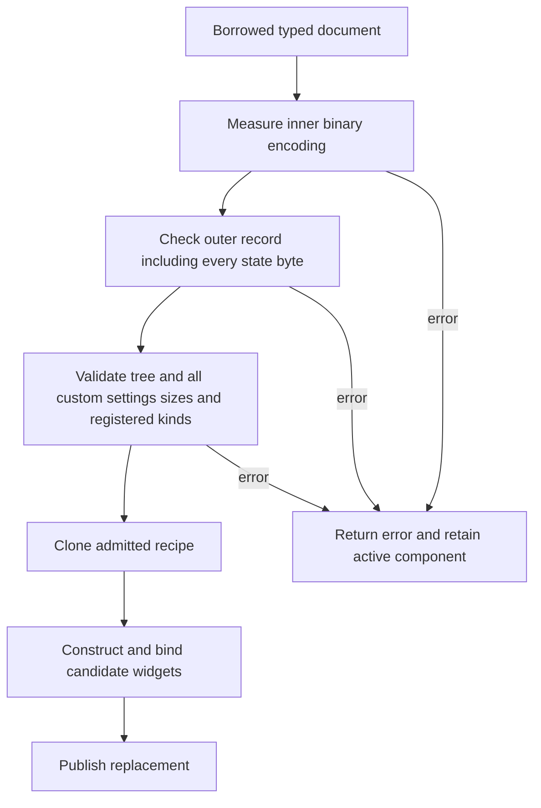

# UI document resource admission

A typed UI document must be saveable under the existing binary persistence policy
before the loader clones it or constructs any widget. This applies equally to
built-in widgets, local custom factories and custom factories discovered through
COM. A failed candidate leaves the published component and its generation intact.
The caller still owns any input it allocated before calling these APIs.

## One binary policy in both directions

The binary codec retains its existing symmetric accounting. No format, COM ABI,
schema revision or numerical budget changes are part of this fix.

| Budget | Current document policy | Meaning |
| --- | --- | --- |
| Encoded bytes | 16 MiB | Complete NCB encoding, including framing |
| Immediate elements | 16,777,216 | Entries in any one collection |
| Cumulative values | 1,000,000 | Every scalar/container visited in that encoding |
| Value depth | 192 | Values along a root-to-leaf serialization path |
| Persistent objects | 1 | One authored recipe, with no persistent child records |
| Authored nodes | 4,096 | Widget and container nodes including the root |
| Authored depth | 32 | Nodes along an ownership path including the root |

Binary limits apply independently to the inner typed document and the outer
`ObjectRecord`. The outer state is `Vec<u8>`: each byte is a collection element
and a value. It is not an implicit blob. For the current leaf record, 21 values
belong to the envelope itself, leaving at most 999,979 state bytes under the
million-value budget. Other inner limits must also pass. Thus the 16 MiB ceiling
is not a promise that a 16 MiB document can be saved.

These are per-document admission rules, not a limit on the application's total
number of forms or widgets. They do not cap renderer allocations, plugin-internal
state, image assets, live widget edits or the caller's already allocated storage.
Grid geometry continues to use its separate constructor-selected policy.

## Admission before copying

`Document::validate_binary()` measures the actual inner encoding, checks the leaf
persistence envelope and validates the authored tree. It does not allocate either
encoded buffer. `CustomWidgetRegistry::validate_document()` additionally checks
registered custom schemas. The loader completes that admission before cloning
the recipe, validating/consuming constructor receivers or calling providers.
Reload's application receiver-preparation callback still runs after reserving an
attempt and before invoking the loader; its independently owned work is unchanged.

`binary::encoded_len_with_limits` runs the same encoder used by `to_vec_with_limits`,
with output storage disabled. It shares the encoder/decoder structural budget;
there is no second size formula over document fields. `ObjectRecord::encoded_leaf_len`
uses the same field serializer as an owned record, visiting a virtual byte sequence
without allocating dummy state. Measurement still performs bounded traversal work;
it is not a constant-time promise. Custom `ComSerialize` implementations can
allocate internally, but the document's generated serialization needs no output
buffer during this check.

`Document::to_binary()` performs that same admission before creating even its inner
temporary buffer. Ordinary encoding and decoding remain responsible for enforcing
the same budgets themselves. Measurement is not permission for later unchecked
writes or for changing the input after validation.

`Document::validate()` remains structural validation, including the custom-settings
transport bound. It does not imply binary saveability or available factories.
`Document::from_json`/`to_json` preserve their separate source-format byte policy;
a structurally valid JSON source can exceed binary persistence capacity. Compilation,
binary export and the designer's accepted-edit path reject that source explicitly.

## JSON, catalog descriptions and constructor settings

`neocogi_ui_contracts::design::bounded_json` owns exact JSON byte counting and bounded output.
Both use the ordinary serde JSON serializer with the selected compact or pretty
format. Writes check the remaining budget before reserving or extending output;
capacity requests stay within the selected ceiling and reservation errors propagate.
Preflight counting avoids a document-sized temporary buffer on oversize rejection.
Bounded materialization repeats the check rather than trusting a previous pass.

| Representation | Limit and scope |
| --- | --- |
| Editable document JSON | 16 MiB per input/output document; output uses pretty formatting |
| Catalog description | 64 KiB compact JSON per widget-kind description |
| Custom constructor settings | 64 KiB NCB snapshot per widget, with COM value/element/depth budgets |

Metadata and settings have separate ceilings. A custom node's opaque settings
length is checked before cloning or any provider call. Static custom factories
follow the same size policy as COM-discovered factories. The host cannot interpret
a private plugin schema; the provider validates revision and semantics before
constructing the candidate widget.

`encode_settings` and `decode_settings` use the same NCB limits. The decoder checks
incoming size before parsing; providers apply it to direct COM calls as well as
loader requests. Editor snapshots and construction share one typed provider codec.
The constructor still checks the receiver independently. Settings are stored as
`Vec<u8>` collections inside the document, not as an exempt binary blob.

Counting includes field names, syntax, UTF-8, indentation and escaping. For example,
a Rust newline occupies one byte, but its JSON escape occupies two. Summing string
lengths or using compact size to admit pretty output is incorrect. Recursive authored
trees/type expressions are structurally validated before unbounded serde traversal.

## Designer state and portable resources

The designer uses the shared JSON counter instead of a separate `JsonSizeBudget`.
Before accepting a revision it checks binary saveability and pretty-JSON capacity.
Portable asset names can lengthen existing image-key strings, so both representations
reserve that potential growth before history/preview publication. Binary reservation
charges additional inner bytes and their outer state-vector values; JSON reservation
uses a conservative upper bound on extra escaped bytes.

`validate_binary_with_text_reserve` supports this one shape-preserving transformation:
existing string contents may grow by at most the supplied UTF-8 byte count. It does not
cover new fields, nodes, variants or collections. Such changes require validating the
new document. Reservation does not establish the semantic validity of future names
or custom-settings contents; the designer uses it only for portable image keys.
Overflow or insufficient inner/outer budget fails without copying it.

Previously accepted oversized source is no longer accepted for construction or editor
publication merely because it fits JSON. The original binary limits are deliberately
retained. Existing published state remains usable after rejection; callers may correct
the draft and retry. Binary saveability is not a guarantee of available memory, assets,
compatible custom providers or successful rendering.

## History and acceptance

`cf01e4a0` established bounded document input. `c363630b` removed an unnecessary
binary round trip from typed preparation but left structural validation without
its former persistence admission. `5c4187fa` added COM property transport with a
post-encoding check. `81e71ccf`/`15159eae` addressed designer saveability locally,
leaving separate public entry points and counting implementations.

The correction retains direct typed construction and shared binary policies. It
moves admission ahead of copies, consolidates JSON accounting, and uses exact
serialization rather than reinstating serialize/decode round trips or exempting
byte vectors. No new crate, type erasure, mutable shared state, or wire format is
needed.

Regression coverage includes independent exact/one-short byte, value, element and
depth boundaries; real envelope decoding; allocation fault injection during binary
measurement/output; escaped and aggregate JSON; opaque settings byte budgets;
real COM catalog constructor call counts; measured rejected-export/compile allocations;
exact-boundary component saving; failed reload preservation; portable image-key growth;
and independent-plugin calls with malformed and oversized settings.

The plugin-editor revision replaces the historical property JSON transport with
opaque NCB snapshots. Earlier JSON-property tests cited in the history describe that retired
representation; current regressions exercise symmetric NCB settings budgets.
