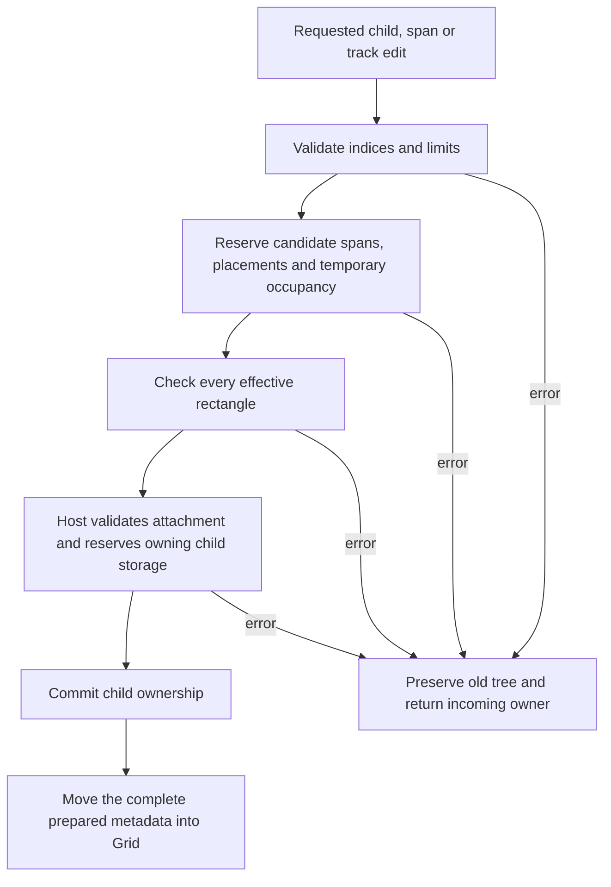

# Grid placement, resource policy, and ownership

Grid accepts an edit only after it has prepared the complete resulting placement.
The nodes provider owns this rule; the document loader and designer call the same
COM factory and edit methods. There is no second placement algorithm in the loader.

## Construction policy

```rust
let limits = GridLimits { max_columns: 8, max_rows: 32 };
let mut grid = ui.widgets().grid(
    &[LayoutTrack::Content; 3],
    &[LayoutTrack::Content],
    limits,
)?;
```

The Grid above starts with three explicit columns and one explicit row. It can
accept up to eight column tracks and 32 total rows. Limits are **ceilings**, not
initial dimensions, minimum sizes, or a request to allocate the maximum bitmap.
They remain immutable and are available through `grid.limits()`.

- Both maxima must be positive and at most `i32::MAX`, matching layout's track
  count arithmetic. Their checked product must fit `isize` on the receiving target.
- Explicit column/row counts cannot exceed their corresponding maxima.
- An empty track list implies one `Content` track. Children can create implicit
  rows, but explicit and implicit rows share the same ceiling.
- A span's row and column requests must be positive. Requested width is clamped
  at the right edge of the actual columns. Requested height is never clamped.
- Every accepted rectangle's end row, end column and flat bitmap index stay
  within the policy. Arithmetic is checked before allocation or indexing.
- Zero/invalid values return `NC_E_INVALID_ARG`; exceeded ceilings, invalid
  indices and unrepresentable products return `NC_E_OUT_OF_RANGE`. Fallible
  reservations return `NC_E_OUT_OF_MEMORY` if storage cannot be obtained.

The maxima are supplied explicitly by each application. Fixed examples use their
actual needs: the calculator selects 4 × 5 and the gallery 3 × 3. Designer preview
uses 64 × 256, hence at most 16,384 occupancy entries per Grid. The runtime-UI
example selects the same policy. These selections are not a universal library
default or a document field.

`Loader::new(..., grid_limits)` and `ReloadSlot::new(..., grid_limits)` carry the
host's policy into every built-in Grid construction, including custom-registry
loader variants. A JSON/NCB recipe cannot increase it. Serialization checks the
portable recipe; compilation checks this host's runtime policy. Thus the same
valid saved document can compile under a larger host and be rejected under a
smaller one. A failed reload preserves the existing component and its handles.
Custom providers remain responsible for the resource policy of their own widgets.

## Whole-rectangle placement

Children are considered in ownership order. Search proceeds in row-major order
from the position after the preceding child's effective width. It does not
backfill earlier holes. Every cell of the candidate's effective rectangle must
be free; a free top-left cell alone is insufficient.

For three columns and requested spans A=(1,1), B=(1,2), C=(1,1), D=(2,1):

```text
Old origin-only check:          Complete-rectangle check:
row 0   A    B    C             row 0   A    B    C
row 1   D   B+D   .             row 1   .    B    D
```

D cannot start at row 1 / column 0 because its second cell intersects B. At
column 2, its requested width of two clamps to one, so it fits there. Testing and
publishing use exactly the same footprint. Occupied cells below the first row
also reject a tall candidate.

The row ceiling bounds search, including a sequence of individually valid spans
whose cumulative placement no longer fits. A one-column Grid with a two-row
ceiling accepts one height-two child and rejects a subsequent height-one child.
A `u32::MAX` row request is rejected under ordinary host limits without attempting
to allocate billions of cells.

## Prepare, accept ownership, publish



The existing `ContainerAlgorithm` boundary separates `prepare_edges` from
`commit_edges`. Grid uses its existing `GridItems` representation as the candidate.
Linear and Form have no derived placement: their preparation validates indices
and reserves the metadata vector. The host also reserves its owning child vector
before consuming a child's one-time mount claim. There is no rollback protocol,
extra widget lifetime state, interior-mutability wrapper, or new ownership type.

For an insertion or replacement:

```rust
match grid.insert(index, child, GridExtent { columns: 1, rows: 2 }) {
    Ok(()) => { /* Grid now owns the child. */ }
    Err((status, child)) => {
        // This is the exact original owner. It was not attached or destroyed.
        // Retry it in another suitable parent, or let the application drop it.
    }
}
```

Replacement rejection also preserves the existing child. A host-level rejection
(such as a child belonging to another runtime) discards the unpublished candidate
plan. Successful publication is only a move of already validated metadata; it
performs no allocation or fallible validation.

`set_edge`, `set_columns`, and removal also prepare the complete resulting plan.
`set_rows` validates/copies the row policy before replacement; it cannot change
placement and uses the same ceiling as the already-validated implicit rows.
Clearing prepares an empty plan without allocating replacement placement storage.
Layout/measurement remain separate fallible phases: a custom child's measurement
may still fail after an otherwise valid edit. This contract covers structural
admission, not a promise that every later render callback succeeds.

### Removal can change the effective spans

Right-edge clamping means removing a child does not necessarily reduce the
required row count. With three columns, three maximum rows and spans
`[(1,1), (1,1), (2,2), (2,2)]`, both tall children initially fit: the third child
clamps to one column. Removing the first child makes the third child's effective
width two; the last child then cannot fit within three rows. The removal returns
`NC_E_OUT_OF_RANGE` **before dropping any child**. All original edges and owners
remain unchanged. The application can clear the container, remove a different
child first, or change a span before retrying. Limits are not silently enlarged.

## Resource cost and why this replaced the old path

For actual columns C, row ceiling R and N children, occupancy is bounded by
C × R entries; accepted disjoint positive rectangles also bound N by C × R.
There are at most C × R candidate origins per plan. A rectangle check can inspect
up to C × R cells, so the simple algorithm has a conservative quadratic search
bound in that cell ceiling, not a claimed linear-time guarantee. Applications
must choose practical limits. This is a per-Grid policy, not a global document
memory or frame-time budget.

Only actual accepted footprints grow the temporary bitmap, using fallible
reservation. Grid retains spans and placements after preparation, not occupancy.
A mutation temporarily keeps both the old and candidate metadata, plus occupancy;
this makes rejection simple and leaves read-only measurement allocation-free.
Mutable layout reuses its row/column buffers and reserves their bounded capacity
fallibly. No giant-policy preallocation is performed.

The previous implementation originated with origin-only span placement in
`3b1ac8a6`, moved placement work into a mutation-time cache in `22c03503`, and was
carried through the COM/container and document migrations (`13f0dbb6`, `cf01e4a0`).
Caching served immutable measurement, but the edit boundary treated metadata
rebuilding as infallible and ran it after attachment. Constructor limits alone
would leave that ordering defect; a late error would arrive after ownership had
already changed. Preparing before host acceptance fixes both admission and order.
This resolves A28 findings 03–04 and consolidated audit group 02.

## Regression coverage

- Grid algorithm tests: reported overlap, below-origin occupancy, preserved
  clamping, checked product overflow, huge-height rejection, cumulative/exact row
  limits, and enumeration of 625 small spanning inputs with geometric checks.
- Real generated COM/runtime tests: invalid constructor policies and explicit
  tracks; insert/replace/set-edge/set-columns/set-rows/remove/clear; unchanged
  geometry and metadata after rejection; exact owner identity and successful
  retry; preserved old subtree; reflowing removal; host rejection after planning.
- Document/runtime tests: typed and binary construction, JSON-round-tripped
  rejected recipes, host-dependent capacity, and failed reload preservation.

Sources: [placement and preparation](../../crates/ui/nodes/src/containers/grid.rs),
[shared edit boundary](../../crates/ui/nodes/src/containers.rs),
[COM regressions](../../crates/ui/runtime/src/runtime/tests/containers/grid.rs),
[loader regressions](../../crates/ui/runtime/src/runtime/tests/retained/reload.rs).
