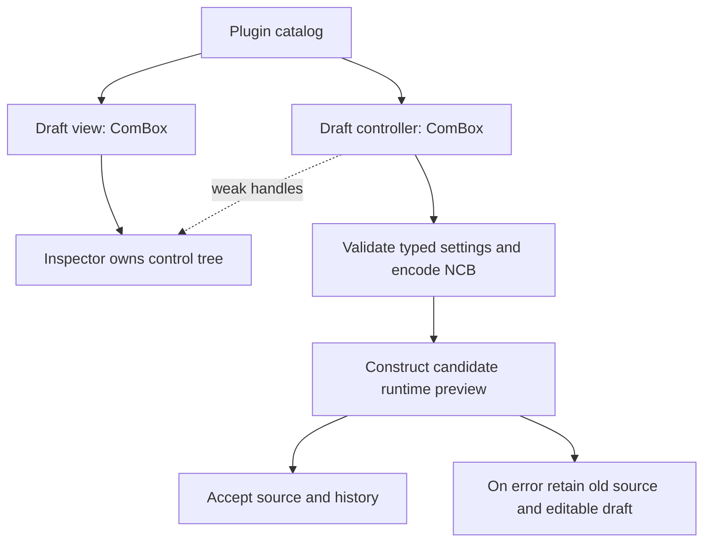

# Plugin-owned designer settings

The designer discovers optional authoring support through COM. It does not inspect
Rust object memory or invent a second property schema beside a plugin's settings.
A runtime-only plugin need not expose a catalog. A catalog can expose constructible
kinds without providing a settings editor for each kind.

## Three contracts with separate purposes

| Contract | Authority | Consumer |
| --- | --- | --- |
| Exact interface identity and checked wire records | IDL and COM codecs | Host/plugin method calls across independent builds |
| Reachable logical value graph and Rust binding paths | Generated IDL metadata copied through the catalog | Event inspector and generated application forms |
| Settings schema and editing UI | The widget plugin | Its constructor and optional designer editor |

`ABI_STRUCT_LAYOUT`, `NcAbiFieldLayout`, `NcAbiStructLayout` and `ComStruct` were
removed because no current consumer needed application-memory offsets. Their
former identity role moved into IDL fingerprints (`57cd9101`); live calls use
checked wire records (`a3de006b`). Recursive `BORROW_WIRE` proofs still compare
actual layouts where direct numeric borrowing is safe. Removing unused reflection
does not remove these proofs, boolean validation, or cross-library ABI checks.

Explicit method diagnostic descriptors remain available and tested. The CLI
`neocogi-inspect` reads plugin manifests for dump/check/plan/diff; it does not
reconstruct IDL or activate a designer editor. The old CLI method reader was
removed during the factory migration (`dbda3f78`); `f7f6d7bd` deliberately retained
explicit diagnostics while avoiding their retention by ordinary projections.

## What crosses COM

`IDesignWidgetCatalog` revision 3 supplies `describe`, `create_widget` and
`create_editor`. Descriptor schema 10 carries bounded opaque NCB defaults plus
the existing logical event graph. UI document revision 7 stores:

```rust
WidgetSpec::Custom {
    kind: "example.counter".into(),
    settings: encoded_ncb,
}
```

Only the plugin interprets `encoded_ncb`. Its private persistent record must
identify its schema revision and reject unsupported revisions. For example the
example plugin keeps a versioned record with a positive `step` and:

```rust
enum Mode {
    Unlimited,
    Bounded { minimum: u32, maximum: u32 },
}
```

The bounded case validates `minimum <= maximum` as one policy. These private
settings need neither IDL reflection metadata nor a generic setter interface.
The runtime constructor and editor call the same typed NCB decoder/validator.
The ordinary typed counter factory and catalog share the same default settings.
Runtime resources, widget references and event queues are not serialized into
settings: factories receive the host and exact event receiver separately.

The old `CustomProperty`/`CustomValue` four-scalar model and its JSON transport are
removed, with no migration fallback. Old document/catalog revisions are rejected.

## Editor ownership and lifecycle

The plugin receives the designer runtime's concrete `UiFactory` capability and
constructs its controls. It returns one `ComBox<IDesignSettingsEditor>` controller.
`take_view()` transfers its `ComBox<IWidget>` view exactly once. The inspector
then owns that control tree. The controller uses weak handles to read controls;
there is no shared widget ownership or parent backpointer.

The controller is separate from the view so a plugin can use ordinary built-in
controls without implementing a forwarding widget/container solely to expose a
settings method. The example needs no private queue: textboxes own their draft
text, and the controller reads it when Apply runs after input dispatch.



`create_editor` returns `NC_E_NOINTERFACE` only for deliberate editor absence.
The inspector shows a read-only notice; runtime construction and application form
bindings still work. Other editor errors are failures, not capability absence.

Rebuilding the inspector, switching selection or switching to the Events tab
discards unapplied plugin drafts. Undo/redo rebuilds from the accepted snapshot.
After view destruction weak control calls fail; after controller destruction old
Apply messages fail the installed-editor identity check and are ignored. No
explicit close state, event port or runtime settings attachment is introduced.

## Snapshot and commit rules

1. `settings(output)` validates the entire current draft and returns its required
   NCB length. A short output is untouched; offset must be zero.
2. The host checks the length against 64 KiB before allocating, then copies it.
   The provider must return stable bytes while the host performs the two calls
   without dispatching UI input. A changed length is rejected. This is a trusted
   in-process plugin contract, not a sandbox against arbitrary native code.
3. `encode_settings` and `decode_settings` use identical NCB byte, value, element
   and depth limits. The host stores opaque bytes; the provider validates its
   concrete schema/revision and semantics, including on direct constructor calls.
4. Apply prepares the candidate document/history and constructs its preview through
   the normal replace-on-success loader. Any failure leaves source/history/preview
   uncommitted and keeps the draft mounted for correction.
5. Successful preview publication is followed by infallible history acceptance.
   Failure to display the success acknowledgement does not turn it into a failed
   commit. Each Apply creates a normal undo revision; applying unchanged settings
   creates no revision.

The complete document's ordinary binary policy still applies, including the outer
persistence envelope and each settings byte as a collection element/value. The
64 KiB settings ceiling does not override a smaller remaining document budget.
Catalog JSON has its separate 64 KiB limit; byte-array expansion counts toward it.

The designer creates a replacement preview rather than deserializing into an
already mounted widget. That preserves the constructor validation boundary and
keeps initialization distinct from live application commands.

## Verification

The COM suites passed 273 tests (four existing ignored), including nested checked
values, native C calls and explicit diagnostic retention. Settings, catalog and
document suites passed 33 tests; runtime admission passed four tests. Four IDL
Rust-path tests include compiling exported forms after real catalog discovery.
Workspace compilation passed.

The full offscreen designer suite passed 37 tests. Its independent shared-plugin
case exercises nested settings through real controls, invalid drafts, short output,
one-time view transfer, view/controller
expiry, stale Apply commands, save/load, undo/redo and valid-draft constructor
failure. Pure provider and transport fixtures cover unsupported revisions, malformed/
trailing NCB, oversized/changing output lengths and allocation-status propagation. These checks do not claim a measured binary-size
reduction or a new complete compiler-version interoperability matrix run.
