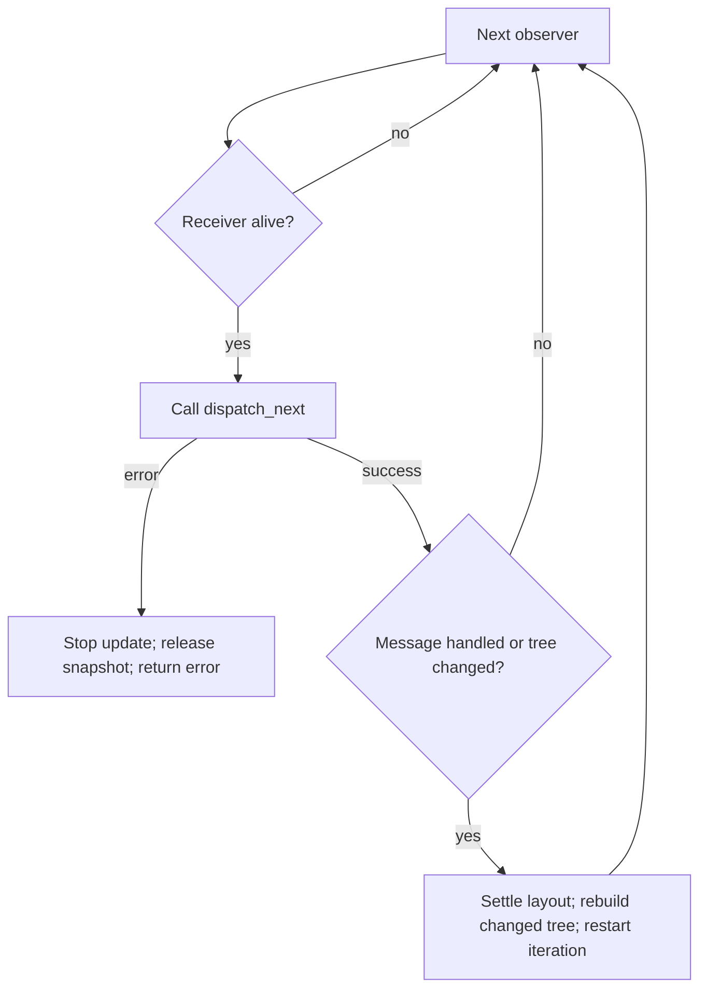

# Widget-owned event dispatch

`IWidgetDispatcher::dispatch_next(&mut self) -> Result<bool>` is the optional private-message
operation queried on the widget's same concrete allocation. A composite owns its
model and receiving endpoint directly. Each call
attempts at most one message; `true` means one message was handled and `false`
means no work was available. A handler error consumes the attempted message and
leaves its successors queued. The COM mutable borrow gate protects the same
allocation used for widget editing and rendering.

Ordinary controls forward constructor-queued events to their behavioral parent.
Passive controls, `HostedWidget` and `LeafContent` do not advertise a dispatcher.
A custom `DispatchingLeafContent` uses `WidgetFactory::dispatching_leaf`; its
message handling shares the leaf's existing exclusive COM gate. Independent composites
advertise `IWidgetDispatcher` on their widget allocation only when they own private
behavior. IDL methods remain declarations, without implementation bodies.

Dispatch belongs outside input, layout and paint traversal. A handler can edit
other widgets through COM while using ordinary `&mut self` for its own state.
It must not call back into its own COM projection to obtain another mutable
borrow. Removal of its own subtree is requested through its behavioral parent's
channel; only the parent decides after the active call returns. Posting intent
alone does not discard or stop the widget's remaining private messages.

The sole `ComBox` owner replaces a widget close phase. Dropping it rejects new
calls and destroys its value, private inbox and owned descendants before returning.
A self-removal request runs only after the current handler has returned. Already posted application facts
remain in the application inbox. See [exclusive ownership](EXCLUSIVE_WIDGET_OWNERSHIP.md).

Whole-runtime shutdown is a terminal application decision: `Ui::close()` drops
its context without publishing individual window/popup lifecycle events or
executing pending dispatch. It leaves application-owned queued facts intact.
Required request completion precedes shutdown; see the
[context shutdown contract](UI_RUNTIME_SHUTDOWN.md).

## Ownership and publication

A composite is the mounted widget. FileDialog embeds its Linear root, model and
receiver in one allocation and exposes IWidget, IWidgetDispatcher,
IContainerLayout and IFileDialog.
It mutates its own fields directly and calls distinct children through COM.
`IEventOwner`, its mount/retire methods, `Mount`, and the separate view/controller
wrapper no longer exist. The existing widget mount claim still rejects movement
or second attachment.

The application is not required to be a widget. `IApplicationDispatcher` has
`dispatch_next` and ordered input bookkeeping; the runtime borrows it for one update and retains nothing.
The application-owned Dispatcher has ordinary processor/receiver fields and no
attachment/retirement phases.

`Loader::compile` constructs a document recipe, weak lookups and one unmounted
root owner. `take_root()` or a consuming mount transfers that owner to the tree.
The metadata can then be dropped independently. Rejected candidates are destroyed
automatically, including when validation retained weak handles.

## Scheduling and cost

The runtime follows actual surface ancestry, visiting dispatcher descendants before
parents and reverse forest chronology between unrelated siblings. It settles
private work before the next application message or raw input event. Topology
changes invalidate the snapshot before its next entry, regardless of the
callback's reported message flag. Its widget references are cleared after each
update, while vector capacity is reused.

`DispatchWidgets` owns that buffer and exposes an iterator, without an external
index or cursor. Each `next()` skips weak observers that have already expired and
yields an owned weak handle for a live receiver. This is the thread-local UI:
iteration does not pin values, and generated COM entry points retain their normal
lifetime/borrow admission checks. Liveness is checked when advancing, not once at
snapshot construction.

The update checks the scratch collection out of its existing cache and passes it
through scheduling with `&mut`. No `RefCell` borrow spans a callback. On success
or any returned error, the update clears all weak entries, restores the buffer for
capacity reuse and marks the next update for a fresh tree collection.

For a yielded receiver the scheduler executes `dispatcher.dispatch_next()?`. Every
handler error stops the update, including `NC_E_DROPPED` from an expired dependency
and `NC_E_CLOSED` from a closed service. Neither status identifies which object
failed. A dequeued message remains consumed; its successors, later widgets,
application messages and unattempted raw input wait for a later update. No partial
frame is committed and no already-performed handler mutation is rolled back.
See the [lifetime error contract](https://github.com/NeoCogi/neocogi-com/blob/92fa66ebc70888f71f2d07f2bbc14335a2ffd4e6/docs/contracts/COM_LIFETIME_ERRORS.md) for exact status meanings.

After a handled message or a topology change, iteration stops so layout can settle
and a new pass can begin. A changed tree is rebuilt first; merely skipping expired
entries would miss newly inserted widgets. A handler that changes another idle
subtree and then fails still propagates its error. The changed tree survives and
the next update rebuilds from it.

The diagram describes a pass while entries remain. Exhausting the iterator follows
the ordinary outer scheduling rule: settle any reconciliation work, otherwise
attempt the next application message.

Nodes cache a typed weak dispatcher projection at construction. A conservative
host-owned count includes unmounted dispatchers and permits a zero-count fast path;
a positive count always selects from the authoritative mounted forest. This is
capability discovery, not a ready-inbox protocol. No delivery tickets or second
lifetime registry are introduced. Passive trees perform no private dispatch calls.

Geometry mutation has a separate conservative notification contract. Independent
providers keep their sticky `take_change` marker and also call
`IWidgetHost::mark_geometry_changed` after committed geometry edits, including
hidden and unmounted widgets. Notify even when later work fails after commit; a
pre-commit notification is harmless. The runtime alone collects sticky changes
when notified, including render admission and retries. Notifications during a
collection remain pending for the following collection.

Application dispatchers call `MessageProcessor::apply_pending_changes` when no message
is available, including after sender disconnection. The default returns
`ApplyOutcome::NothingPending`; consuming coalesced publication or other pending
work returns `ApplyOutcome::ChangesApplied`. This is an empty-inbox operation,
not a once-per-frame callback: it can run before the first raw input and after
each input, several times per update. Repeated idle calls must not create work.

`IApplicationDispatcher` v1 returns the generated `ApplicationDispatch`
enum: `MessageHandled`, `PendingChangesApplied`, or `Idle`. Both work outcomes
charge the shared budget and revisit child dispatch/layout before later input,
even when applying changes only posts a private message without a geometry edit.
`Idle` ends the boundary only when geometry/topology notifications are quiet too.
Unknown wire values are rejected with `NC_E_INVALID_TAG` before later input.
Busy admission cannot consume a message or enter the pending-change hook; errors
stop the update, preserve committed edits, and leave retry policy with the model.
Geometry edits still require their normal sticky markers and host notifications.
Tools apply publication under the existing application mutable gate. The demo host
calls one outer update. Its `after_update` hook performs
independent preview rendering and paint-only cache publication. `LeafContent::paint`
receives `&mut self` for these caches; host observation still rejects geometry edits.

### Ordered input bookkeeping

`input_boundary(InputBoundary)` brackets each consumed raw input with Begin and
End. Begin carries the normalized screen-space `WidgetEvent`; Text identifies
the kind without copying its UTF-8 bytes. Both notifications run outside runtime
context/traversal borrows under the application mutable gate. They record
bookkeeping only: geometry edits and enqueuing more raw input belong outside
these hooks. The default Rust processor/host hook does nothing.

After Begin, the runtime routes that input and settles all descendant and
application messages before End. End is attempted even if Begin, routing or
dispatch fails; the first failure remains authoritative. A failed Begin consumes
the attempted input without routing it; later input stays queued. An eventless
update and initial pending-work dispatch have no input scope. One consumed scope
charges one unit of the shared dispatch budget when an application is present,
including inputs that post no messages.

Applications that defer decoding can enqueue these markers in the same owned
FIFO as semantic events. Each decoded command then carries its own input identity,
instead of consulting native polling state that may already describe a later
gesture. The theme editor uses this rule for Undo groups. Semantic events still
travel as their original `ComBox<IEvent>` and weak widget origin; bookkeeping
does not translate or wrap their payload interfaces. The v1 structural contract requires
rebuilding application and UI components together.

Runtime dispatch snapshots contain weak handles and cannot retain removed values.
Owner Drop rejects new calls and destroys the complete owned value before returning.
Thread-local removal preflights the existing subtree borrow state and returns Busy
if it would recursively destroy an executing method. A widget posts close intent
to its existing behavioral parent channel. Only the parent decides whether and
when to remove it. Neither intent nor a returned error authorizes removal;
explicit edits already completed inside a failing handler remain committed.
The runtime has no special removal-request queue. Weak local construction
access uses scoped closures instead of escaping guards. ThreadSafe COM Drop waits
for concurrent admitted calls, then destroys on the dropping thread.

See the [event guide](../../crates/ui/runtime/docs/EVENTS.md) for error semantics,
work budgets, compiled-form lifetime, and application examples. The superseded
`IEventOwner` and separate mount/retire design remains in Git history (`6078b286`
replaced it with behavior on the mounted widget).

## Iterator and failure regressions

The September 30 review traced the status suppression to `2cb90ec9`, which replaced
strong dispatch snapshots with weak observers. Weak snapshots correctly stopped
retaining removed widgets, but the scheduler used a method error as an inferred
lifetime check. Separating status names alone did not fix live `CLOSED` errors.

The current regression suite covers:

- Expiry before and between iterator advances, live ordering, weak-only results,
  and scratch capacity reuse.
- Real mounted leaves and composites returning `CLOSED`, `DROPPED`, or an ordinary
  invalid-argument error; successors and application work wait until retry.
- A live handler accessing a genuinely destroyed widget through generated COM.
- Removing another subtree and then failing; its queued work is destroyed and
  retry uses the changed tree without replaying the failed message.
- Queued textbox input staying untouched until the failed dispatch is retried.
- Existing child-first delivery, callback insertion/removal, work-budget limits,
  reentrancy rejection and warmed idle-allocation checks.

These changes add no dispatch ticket, per-widget active flag, new close phase or
second queue. The older verification section above remains historical evidence.

## Inline leaf geometry publication

`DispatchingLeafContent::dispatch_next` receives a borrowed `LeafDispatchContext`
for the owning leaf's existing `WidgetState`. Call `geometry_changed()` immediately
when private behavior commits a preferred-size input. This retains the local
sticky change and notifies the host, allowing layout to settle before the next
queued input. Returning `true` describes private work, not geometry. A callback
returning `false` after a geometry edit still owes publication; returned errors
also retain conservative invalidation. A later ordinary update is not a substitute
for publication before hit testing. The context cannot outlive the admitted call.

Runtime-owned invalidation uses the same scheduling invariant: whenever a callback
failure marks a retained node dirty, it schedules the host collector. Pre-commit
provider failures owe no semantic mutation notification, but must still recover
on a later successful update without an unrelated setter or notification.
